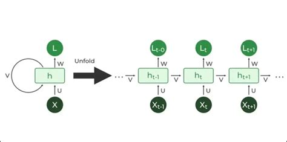
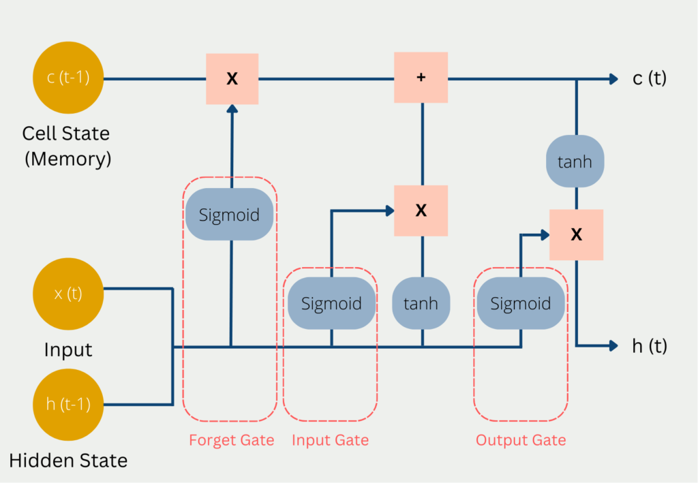
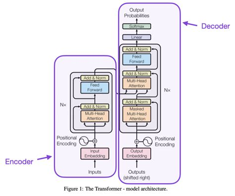

# Understanding Transformer Architecture

Companion pages linked from the lesson:

- Worked example, "I love learning" → "أنا أحب التعلم", with actual calculations for every Transformer operation (English): https://albanna-tutorials.com/transformer-step-by-step.html
- Same worked example in Arabic: https://albanna-tutorials.com/transformer-step-by-step-ar.html
- Transformer Q&A (21 questions): https://albanna-tutorials.com/transformer-qa.html

*An interactive guide to modern neural networks.*

## Introduction

The Transformer architecture was introduced in the 2017 paper **"Attention Is All You Need"** by Vaswani et al. Earlier sequence models processed data one step at a time; the Transformer instead uses **self-attention** to process an entire sequence at once. This parallelism allows Transformers to:

- Capture long-range dependencies more effectively
- Train faster through parallel processing
- Scale to larger datasets and model sizes
- Reach state-of-the-art results on many NLP tasks

**Key innovations**

1. Self-attention mechanism
2. Multi-head attention
3. Positional encodings
4. Layer normalization
5. Residual connections

**Models built on the Transformer**

- Large language models (GPT, LLaMA)
- Bidirectional encoders (BERT, RoBERTa)
- Text-to-image models (DALL-E, Stable Diffusion)
- Multimodal systems (CLIP, Flamingo)

## Evolution of Sequence Models

### Recurrent Neural Networks (RNNs)

<figure class="fig"><figcaption>A recurrent network folded (left) and unfolded through time (right). The same weights U, V and W are reused at every time step, and each hidden state h<sub>t</sub> depends on h<sub>t-1</sub>, so the steps must run one after another.</figcaption></figure>

- Slow, because they process sequences step by step
- Suffer from vanishing or exploding gradients
- Have a limited context window
- Struggle with long-range dependencies

### Long Short-Term Memory (LSTM)

<figure class="fig"><figcaption>An LSTM cell. The forget gate decides what to erase from the cell state c(t-1), the input gate decides what new information to add, and the output gate decides what part of the cell state becomes the hidden state h(t).</figcaption></figure>

- Handle long-term dependencies better than vanilla RNNs
- Use gates to regulate information flow
- Reduce the vanishing-gradient problem
- Remain sequential and computationally expensive

### Transformer

- Process sequences in parallel
- Use self-attention to model global context
- Scale efficiently with computing resources
- Avoid recurrence, which makes deeper architectures practical

### Performance comparison

The table compares the three model families across sequence lengths and tasks such as machine translation, text summarization, text classification and question answering.

| Property | RNN | LSTM | Transformer |
|---|---|---|---|
| Processing | Sequential | Sequential | Parallel |
| Long-range dependencies | Poor | Better (gated) | Strong (global self-attention) |
| Gradient issues | Vanishing / exploding | Reduced | Largely avoided (residuals + LayerNorm) |
| Context | Limited window | Longer, still bounded | Whole sequence |
| Scalability | Low | Moderate | High |

## Transformer Architecture

The Transformer consists of an **encoder** and a **decoder**, each built from a stack of identical layers. Every layer contains **multi-head self-attention** and a **position-wise feed-forward network**, wrapped with residual connections and layer normalization. (The original diagram has buttons to highlight the encoder, decoder and attention paths.)

<figure class="fig"><figcaption>The Transformer model architecture (Figure 1 in Vaswani et al., 2017): encoder on the left, decoder on the right.</figcaption></figure>

### Encoder

- Stacks N identical layers (N = 6 in the original paper)
- Each layer has two sub-layers: multi-head self-attention and a position-wise feed-forward network
- Residual connections and layer normalization surround each sub-layer
- Outputs a sequence of contextualized representations

### Decoder

- Also stacks N identical layers
- Each layer has three sub-layers: **masked** multi-head self-attention, multi-head attention over the encoder output (cross-attention), and a position-wise feed-forward network
- Masking preserves the autoregressive property (a position may not attend to future positions)
- Outputs probabilities for predicting the next token

{{display: decoder}}

Positional encodings are added to the input embeddings before the first layer. The feed-forward inner dimension is typically 4× the model dimension.

### Mathematical formulation

Scaled dot-product attention:

$$\text{Attention}(Q, K, V) = \text{softmax}\left(\frac{QK^T}{\sqrt{d_k}}\right)V$$

Multi-head attention:

$$\text{MultiHead}(Q, K, V) = \text{Concat}(\text{head}_1, \ldots, \text{head}_h)W^O$$

$$\text{where } \text{head}_i = \text{Attention}(QW_i^Q, KW_i^K, VW_i^V)$$

Position-wise feed-forward network:

$$\text{FFN}(x) = \max(0, xW_1 + b_1)W_2 + b_2$$

Layer normalization:

$$\text{LayerNorm}(x) = \gamma \cdot \frac{x - \mu}{\sqrt{\sigma^2 + \epsilon}} + \beta$$

## Key Components

### Self-attention mechanism

Self-attention lets every position in a sequence attend to every other position. Step by step:

1. Each token is projected into a **query** (Q), **key** (K) and **value** (V) vector through learned linear projections.
2. Compatibility scores are computed between each query and all keys (dot product).
3. Softmax turns the scores into attention weights.
4. Each output is the weighted sum of the value vectors using those weights.

The scaling by √d_k keeps the dot products from growing large and pushing softmax into regions with extremely small gradients.

For example, take **"The cat sat on the mat because it was tired."** The word "it" refers to the cat: being tired fits a living thing, not a mat. Change one word, **"The cat sat on the mat because it was soft."**, and "it" now refers to the mat. A model has to use context to tell the two apart, and attention is how it does so: "it" puts most of its attention on the word it refers to. Open the **Attention: what does "it" refer to?** animation to compare the two sentences (the attention values there are illustrative), and the **Self-attention** animation to follow the computation step by step.

{{display: pronoun attention qkv}}

### Multi-head attention

Instead of a single attention function, the model runs **h** attention heads in parallel, each with its own projection matrices, so it can attend to information from different representation subspaces at once. Benefits:

- Captures several kinds of relationships simultaneously
- Some heads focus on syntax, others on meaning
- Greater representational power
- An ensemble-like effect within a single layer

For example, take the start of the sentence used in Figure 4 of the original Transformer paper (Vaswani et al., 2017): **"The Law will never be perfect, but its application should be just."** The same word can be handled by different heads, each following a different relation. Published analyses found heads of these kinds:

| Head | What it links in this sentence | Evidence |
|---|---|---|
| Head 1: coreference | "its" → "Law" (the noun the pronoun refers to) | Vaswani et al. (2017), Fig. 4: heads in layer 5 attend sharply from "its" to "Law". Clark et al. (2019): BERT head 5-4 finds the antecedent of a mention with about 65% accuracy |
| Head 2: determiner → noun | "The" → "Law" | Clark et al. (2019): BERT head 8-11 attends from determiners to their nouns, 94.3% accuracy |
| Head 3: possessive → noun | "its" → "application" (the noun it belongs to) | Clark et al. (2019): BERT head 7-6 attends from possessive pronouns to the noun they modify, 80.5% accuracy |

Notice that "its" appears twice: one head looks back at the noun it refers to, another looks forward at the noun it belongs to. The multi-head output combines both views. These findings come from different models and layers, so the table groups them for teaching; real heads are rarely this clean, and many cannot be given a simple label. Open the **Multi-head attention: one sentence, three heads** animation to follow "its" through project, attend, mix and concatenate.

{{display: heads multihead}}

### Positional encoding

Because the Transformer has no recurrence or convolution, it needs explicit information about token order. Sinusoidal positional encodings are added to the input embeddings:

$$PE_{(pos, 2i)} = \sin\left(pos / 10000^{2i/d_{model}}\right)$$

$$PE_{(pos, 2i+1)} = \cos\left(pos / 10000^{2i/d_{model}}\right)$$

where *pos* is the token position and *i* is the dimension index. Sinusoids at different frequencies let the model learn to attend by relative position.

Viewed as a heatmap (positions as rows, dimensions as columns), low dimensions oscillate quickly and high dimensions slowly. Open the **Positional encoding** animation at the top of this lesson to explore it.

{{display: positional}}

### Feed-forward networks

Each encoder and decoder layer contains a fully connected network applied independently and identically at each position: two linear transformations with a ReLU between them.

$$\text{FFN}(x) = \max(0, xW_1 + b_1)W_2 + b_2$$

- The inner (hidden) dimension is typically 4× the model dimension
- It adds non-linearity and substantially increases model capacity

For an input between −3 and 3, the first layer followed by ReLU produces a piecewise-linear function; a wider hidden layer (4× or 8×) can represent more complex shapes.

## How a Sentence Flows Through the Model

Take the sentence *"The transformer model revolutionized natural language processing with its attention mechanism."* It passes through tokenization → embedding → positional encoding → attention → feed-forward → output, one stage at a time. The animations at the top of this lesson (tokenisation, positional encoding, self-attention) show each stage.

**Attention patterns by task.**

- **Translation:** how attention aligns source and target words when translating.
- **Summarization:** how the model concentrates attention on the key information in a passage.
- **Question answering:** how the model locates the answer span inside a context passage.

## Code Implementation Examples

### Self-attention implementation (PyTorch)

```python
import torch
import torch.nn as nn
import math


class SelfAttention(nn.Module):
    def __init__(self, embed_size, heads):
        super().__init__()
        self.embed_size = embed_size
        self.heads = heads
        self.head_dim = embed_size // heads

        assert self.head_dim * heads == embed_size, "Embed size must be divisible by heads"

        # Linear projections for queries, keys, values and the output
        self.q_linear = nn.Linear(embed_size, embed_size)
        self.k_linear = nn.Linear(embed_size, embed_size)
        self.v_linear = nn.Linear(embed_size, embed_size)
        self.fc_out = nn.Linear(embed_size, embed_size)

    def forward(self, query, key, value, mask=None):
        batch_size = query.shape[0]

        # Project and split into heads: (batch, seq, heads, head_dim) -> (batch, heads, seq, head_dim)
        q = self.q_linear(query).view(batch_size, -1, self.heads, self.head_dim).permute(0, 2, 1, 3)
        k = self.k_linear(key).view(batch_size, -1, self.heads, self.head_dim).permute(0, 2, 1, 3)
        v = self.v_linear(value).view(batch_size, -1, self.heads, self.head_dim).permute(0, 2, 1, 3)

        # Scaled dot-product scores: (batch, heads, seq_q, seq_k)
        scores = torch.matmul(q, k.permute(0, 1, 3, 2)) / math.sqrt(self.head_dim)

        # Optional mask (used in the decoder)
        if mask is not None:
            scores = scores.masked_fill(mask == 0, float("-1e20"))

        # Attention weights
        attention = torch.softmax(scores, dim=-1)

        # Weighted sum of values: (batch, heads, seq, head_dim)
        out = torch.matmul(attention, v)

        # Merge heads: (batch, seq, heads, head_dim) -> (batch, seq, embed_size)
        out = out.permute(0, 2, 1, 3).contiguous().view(batch_size, -1, self.embed_size)

        return self.fc_out(out)
```

### Simplified self-attention (JavaScript)

```javascript
class SelfAttention {
  constructor(embedSize, heads) {
    this.embedSize = embedSize;
    this.heads = heads;
    this.headDim = Math.floor(embedSize / heads);

    if (this.headDim * heads !== embedSize) {
      throw new Error("Embed size must be divisible by heads");
    }

    // Weight matrices (random init, for demonstration only)
    this.wQ = this.initializeWeights(embedSize, embedSize);
    this.wK = this.initializeWeights(embedSize, embedSize);
    this.wV = this.initializeWeights(embedSize, embedSize);
    this.wO = this.initializeWeights(embedSize, embedSize);
  }

  initializeWeights(inputDim, outputDim) {
    const w = [];
    for (let i = 0; i < inputDim; i++) {
      w.push([]);
      for (let j = 0; j < outputDim; j++) {
        w[i].push((Math.random() - 0.5) * 0.1);
      }
    }
    return w;
  }

  matMul(a, b) {
    const result = [];
    for (let i = 0; i < a.length; i++) {
      result.push([]);
      for (let j = 0; j < b[0].length; j++) {
        let sum = 0;
        for (let k = 0; k < b.length; k++) sum += a[i][k] * b[k][j];
        result[i].push(sum);
      }
    }
    return result;
  }

  softmax(arr) {
    const max = Math.max(...arr);
    const exps = arr.map(x => Math.exp(x - max));
    const sum = exps.reduce((s, x) => s + x, 0);
    return exps.map(x => x / sum);
  }

  transpose(matrix) {
    return matrix[0].map((_, j) => matrix.map(row => row[j]));
  }

  forward(inputs, mask = null) {
    // inputs: one sequence, shape (seqLength x embedSize)
    const seqLength = inputs.length;

    // Linear projections
    const Q = this.matMul(inputs, this.wQ);
    const K = this.matMul(inputs, this.wK);
    const V = this.matMul(inputs, this.wV);

    // (Head splitting / tensor reshaping omitted in this simplified version)

    // Scores = Q * K^T, scaled by sqrt(d_k). Without head splitting the dot products run over
    // all embedSize dimensions, so d_k = embedSize (with heads it would be headDim).
    const scores = this.matMul(Q, this.transpose(K));
    const scaledScores = scores.map(row =>
      row.map(s => s / Math.sqrt(this.embedSize))
    );

    // Mask placeholder (no logic in the demo)
    if (mask) { /* apply mask */ }

    // Softmax over each row -> attention weights
    const attentionWeights = scaledScores.map(row => this.softmax(row));

    // Weighted sum of values
    const output = this.matMul(attentionWeights, V);

    return this.matMul(output, this.wO);
  }
}

// Try it: one sequence of 4 tokens, embedding size 8, 2 heads
const attn = new SelfAttention(8, 2);
const tokens = Array.from({ length: 4 }, () => Array.from({ length: 8 }, () => Math.random()));
const out = attn.forward(tokens);
console.log("input shape: ", tokens.length, "x", tokens[0].length);
console.log("output shape:", out.length, "x", out[0].length);
console.log("first output vector:", out[0].map(v => v.toFixed(4)).join(", "));
```

### Using Transformers with libraries (Hugging Face)

```python
import torch
from transformers import AutoModel, AutoTokenizer

model_name = "bert-base-uncased"
tokenizer = AutoTokenizer.from_pretrained(model_name)
model = AutoModel.from_pretrained(model_name)

text = "Understanding transformers is fascinating."
inputs = tokenizer(text, return_tensors="pt")

with torch.no_grad():
    outputs = model(**inputs)

last_hidden_state = outputs.last_hidden_state
pooled_output = outputs.pooler_output

print(f"Hidden state shape: {last_hidden_state.shape}")  # [batch_size, sequence_length, hidden_size]
print(f"Pooled output shape: {pooled_output.shape}")     # [batch_size, hidden_size]
```

## Applications

### Natural language processing

Machine translation (e.g. Google Translate), text summarization, sentiment analysis, named entity recognition, question answering, and text generation with GPT models.

### Computer vision

Vision Transformers (ViT), image classification, object detection, image segmentation, image generation (DALL-E, Stable Diffusion), and video understanding.

### Multimodal AI

CLIP (linking text and images), text-to-image generation, image captioning, visual question answering, audio-visual understanding, and multimodal chatbots.

### Notable transformer-based models

| Model | Architecture type | Key features | Applications |
|---|---|---|---|
| BERT | Encoder-only | Bidirectional training with masked-token prediction | Text classification, NER, question answering |
| GPT (1–4) | Decoder-only | Autoregressive training, growing model size | Text generation, creative writing, coding, chatbots |
| T5 | Encoder–decoder | Every task framed as text-to-text | Translation, summarization, classification |
| ViT | Encoder-only (vision) | Images treated as sequences of 16×16 patches | Image classification, object detection |
| DALL-E / Stable Diffusion | Generative image models with transformer components (autoregressive in DALL-E 1, diffusion in DALL-E 2 and Stable Diffusion) | Text conditioning, latent diffusion | Text-to-image generation, image editing |

**Model explorer — BERT.** Uses only the encoder and is trained bidirectionally. Pre-training objectives: masked language modeling and next-sentence prediction. Variants: BERT-base (12 layers) and BERT-large (24 layers). Uses: text classification, NER, question answering, sentiment analysis, document retrieval.

## Further Resources

### Key academic papers

- Vaswani et al. (2017), "Attention Is All You Need" — the original Transformer paper. https://arxiv.org/abs/1706.03762
- Devlin et al. (2018), "BERT: Pre-training of Deep Bidirectional Transformers" — introduced BERT. https://arxiv.org/abs/1810.04805
- Brown et al. (2020), "Language Models are Few-Shot Learners" — introduced GPT-3. https://arxiv.org/abs/2005.14165
- Dosovitskiy et al. (2020), "An Image is Worth 16x16 Words" — the ViT paper. https://arxiv.org/abs/2010.11929

### Tutorials and courses

- The Illustrated Transformer (Jay Alammar), visual guide. http://jalammar.github.io/illustrated-transformer/
- "Attention Is All You Need" video explanation. https://www.youtube.com/watch?v=TQQlZhbC5ps
- Hugging Face NLP Course (free, practical). https://huggingface.co/course
- DeepLearning.AI NLP Specialization. https://www.deeplearning.ai/courses/

### Libraries and implementations

- Hugging Face Transformers, the most popular library for pre-trained models. https://github.com/huggingface/transformers
- PyTorch native transformer layers. https://pytorch.org/docs/stable/nn.html#transformer-layers
- TensorFlow transformer tutorial. https://www.tensorflow.org/text/tutorials/transformer

### Community and discussion

- Hugging Face Forums: https://discuss.huggingface.co/
- r/MachineLearning: https://www.reddit.com/r/MachineLearning/
- AI Stack Exchange: https://ai.stackexchange.com/
- #NLProc on Twitter: https://twitter.com/hashtag/NLProc

## Conclusion

Transformers have changed AI, enabling advances in language understanding, generation and multimodal reasoning. The self-attention design is both effective and scalable. Main advantages:

- Parallel sequence processing, overcoming the limits of RNNs
- Effective capture of long-range dependencies through self-attention
- A flexible architecture that applies well beyond NLP
- Scalability to very large models with steady performance gains
- A foundation for state-of-the-art systems across many applications

## Key concepts worth simulating

- **Scaled dot-product attention, step by step:** tokens → Q/K/V projections, Q·Kᵀ score matrix, divide by √d_k, row-wise softmax, weighted sum of V. Show the (seq × seq) heatmap for "The cat sat on the mat because it was tired." and for the "soft" version and let the user click a query word.
- **Why scale by √d_k:** animate how the softmax of random dot products saturates (near one-hot) as d_k grows without scaling, and stays soft with scaling.
- **Multi-head attention:** split embed_size into h heads (reshape/permute), run h independent attention maps side by side on "The Law will never be perfect, but its application should be just.", concatenate, project with W^O. Toggle heads 1–4 and show each head's pattern.
- **Sinusoidal positional encoding heatmap:** PE(pos, 2i)=sin, PE(pos, 2i+1)=cos; vary sequence length (5/25/50) and d_model (8/32/64); show that the dot product between PE vectors depends on relative offset.
- **Token → embedding + positional encoding in a 2D plane:** plot a few token embeddings, add PE vectors, show how the same word at different positions lands at different points.
- **Position-wise FFN:** input slider (−3..3) → xW₁+b₁ → ReLU → W₂; show the hidden layer at 1×/4×/8× width and the piecewise-linear output.
- **Causal (decoder) mask:** show the upper-triangular mask filling scores with −1e20 and how softmax zeroes those positions.
- **RNN vs Transformer processing:** animate sequential hidden-state passing vs. one parallel attention step over the whole sequence; plot steps-to-connect two tokens at distance d (O(d) vs O(1)).
- **Residual + LayerNorm:** show per-token mean/variance normalization (γ, β) on a vector and why it stabilizes deep stacks.

## Test code

```python
# 1. Scaled dot-product attention from scratch (NumPy)
import numpy as np

def softmax(x, axis=-1):
    x = x - x.max(axis=axis, keepdims=True)
    e = np.exp(x)
    return e / e.sum(axis=axis, keepdims=True)

def attention(Q, K, V):
    d_k = Q.shape[-1]
    scores = Q @ K.T / np.sqrt(d_k)
    weights = softmax(scores)
    return weights @ V, weights

rng = np.random.default_rng(0)
seq, d = 5, 8
X = rng.normal(size=(seq, d))
Wq, Wk, Wv = (rng.normal(size=(d, d)) * 0.3 for _ in range(3))
out, w = attention(X @ Wq, X @ Wk, X @ Wv)
print("attention weights (rows sum to 1):\n", w.round(3))
print("row sums:", w.sum(axis=1).round(6))
print("output shape:", out.shape)
```

```python
# 2. Check the PyTorch SelfAttention module from the lesson
import torch
from torch import nn
import math

class SelfAttention(nn.Module):
    def __init__(self, embed_size, heads):
        super().__init__()
        self.embed_size, self.heads = embed_size, heads
        self.head_dim = embed_size // heads
        assert self.head_dim * heads == embed_size
        self.q_linear = nn.Linear(embed_size, embed_size)
        self.k_linear = nn.Linear(embed_size, embed_size)
        self.v_linear = nn.Linear(embed_size, embed_size)
        self.fc_out = nn.Linear(embed_size, embed_size)

    def forward(self, query, key, value, mask=None):
        B = query.shape[0]
        q = self.q_linear(query).view(B, -1, self.heads, self.head_dim).permute(0, 2, 1, 3)
        k = self.k_linear(key).view(B, -1, self.heads, self.head_dim).permute(0, 2, 1, 3)
        v = self.v_linear(value).view(B, -1, self.heads, self.head_dim).permute(0, 2, 1, 3)
        scores = torch.matmul(q, k.permute(0, 1, 3, 2)) / math.sqrt(self.head_dim)
        if mask is not None:
            scores = scores.masked_fill(mask == 0, float("-1e20"))
        att = torch.softmax(scores, dim=-1)
        out = torch.matmul(att, v).permute(0, 2, 1, 3).contiguous().view(B, -1, self.embed_size)
        return self.fc_out(out)

x = torch.randn(2, 7, 64)               # batch=2, seq=7, embed=64
sa = SelfAttention(embed_size=64, heads=8)
print(sa(x, x, x).shape)                # torch.Size([2, 7, 64])

# causal mask: position i may only attend to j <= i
mask = torch.tril(torch.ones(7, 7))[None, None]   # (1,1,7,7)
print(sa(x, x, x, mask=mask).shape)
```

```python
# 3. Sinusoidal positional encoding heatmap
import numpy as np
import matplotlib.pyplot as plt

def positional_encoding(seq_len, d_model):
    pos = np.arange(seq_len)[:, None]
    i = np.arange(d_model)[None, :]
    angle = pos / np.power(10000, (2 * (i // 2)) / d_model)
    pe = np.zeros((seq_len, d_model))
    pe[:, 0::2] = np.sin(angle[:, 0::2])
    pe[:, 1::2] = np.cos(angle[:, 1::2])
    return pe

pe = positional_encoding(50, 64)
plt.imshow(pe, cmap="RdBu", aspect="auto")
plt.xlabel("dimension"); plt.ylabel("position"); plt.colorbar()
plt.title("Sinusoidal positional encoding")
plt.show()
```

```python
# 4. Run BERT with Hugging Face and inspect output shapes
import torch
from transformers import AutoModel, AutoTokenizer

model_name = "bert-base-uncased"
tokenizer = AutoTokenizer.from_pretrained(model_name)
model = AutoModel.from_pretrained(model_name)

inputs = tokenizer("Understanding transformers is fascinating.", return_tensors="pt")
with torch.no_grad():
    outputs = model(**inputs)

print(tokenizer.convert_ids_to_tokens(inputs["input_ids"][0]))
print("Hidden state shape:", outputs.last_hidden_state.shape)  # [1, seq_len, 768]
print("Pooled output shape:", outputs.pooler_output.shape)     # [1, 768]
```
