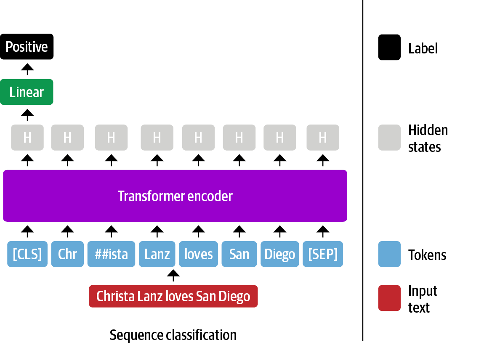
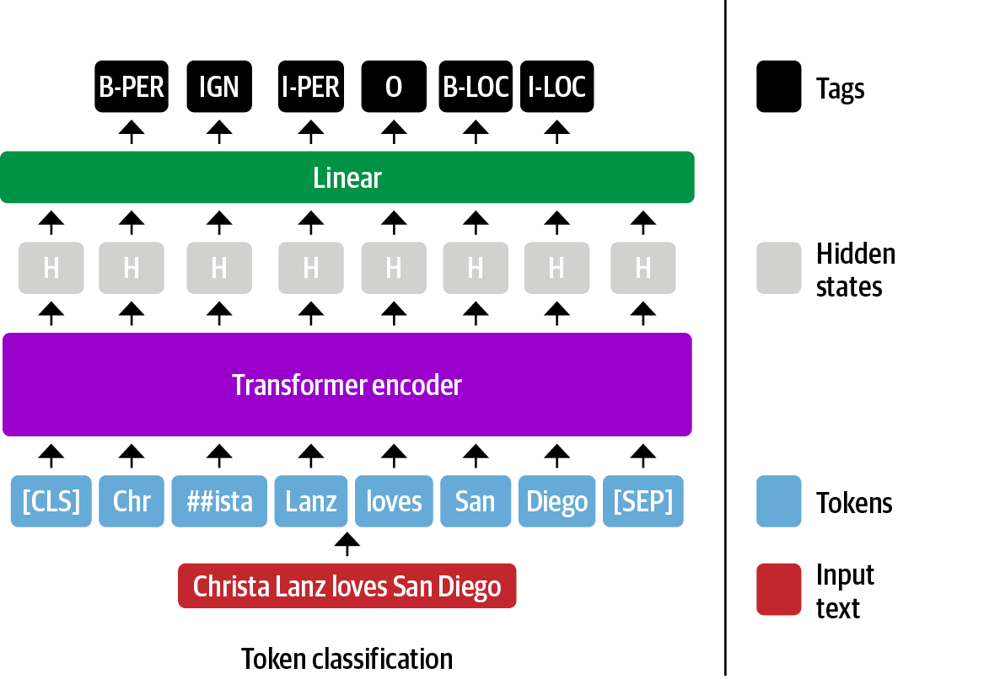
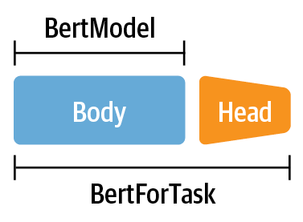
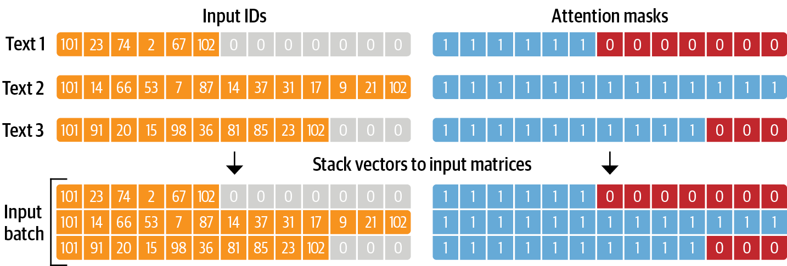

# Named Entity Recognition with Transformers

*From one label per sentence to one label per word.* Level: intermediate · about 75 minutes · Hugging Face Transformers, Datasets, seqeval. The lesson follows Tunstall, von Werra & Wolf, *Natural Language Processing with Transformers* (Revised Edition, 2022), Chapter 4, "Multilingual Named Entity Recognition".

## What You'll Learn

By the end of this lesson you will be able to:

- Explain what named entity recognition is and where it is used
- Read and write entity annotations in the <abbr data-tip="Inside, Outside, Beginning, version 2: B- starts an entity, I- continues it, O is outside any entity" tabindex="0">IOB2</abbr> (<abbr data-tip="Beginning, Inside, Outside: another name for the IOB2 tagging scheme" tabindex="0">BIO</abbr>) scheme
- Describe how a transformer encoder is turned into a token classifier
- Align word-level labels with subword tokens, and explain the label `-100`
- Evaluate an <abbr data-tip="Named Entity Recognition: finding names in text and labelling each with a type" tabindex="0">NER</abbr> model at the entity level with <abbr data-tip="Sequence labelling evaluation: the Python library that scores NER at the entity level" tabindex="0">`seqeval`</abbr>
- Explain zero-shot cross-lingual transfer and decide when it is good enough
- Analyse the errors of an NER model and of its training data

**Goal:** a working multilingual NER pipeline that you can evaluate yourself, and a plan for the **NER Agent** of your project.

**Prerequisites:** [Week 2](week02-text-classification.html). You should be comfortable with tokenisation, the idea of a pre-trained body with a task head, and precision, recall and <abbr data-tip="F1-score: the harmonic mean of precision and recall" tabindex="0">F1</abbr>.

### Abbreviations used in this lesson

Each abbreviation is also explained where it first appears. In the text, an abbreviation with a dotted underline shows its meaning when you point at it, tap it, or reach it with the Tab key. Each one is marked at its first use in every section.

| Abbreviation | Stands for | In one line |
|---|---|---|
| NER | Named Entity Recognition | Finding names in text and labelling each with a type |
| PER, ORG, LOC | Person, Organisation, Location | The three entity types used in this lesson |
| IOB2 | Inside, Outside, Beginning, version 2 | The tagging scheme: `B-` starts an entity, `I-` continues it, `O` is outside any entity |
| BIO | Beginning, Inside, Outside | Another name for the same scheme, with the letters in a different order |
| IGN | Ignored | A token position that the loss skips; stored as the label ID `-100` |
| BERT | Bidirectional Encoder Representations from Transformers | The encoder-only model family from Week 2 |
| DistilBERT | Distilled BERT | The smaller, faster BERT used in Week 2 |
| mBERT | Multilingual BERT | BERT pre-trained on Wikipedia in many languages |
| RoBERTa | Robustly Optimized BERT Pretraining Approach | BERT with an improved pre-training recipe |
| XLM | Cross-lingual Language Model | An earlier family of multilingual models |
| XLM-R | XLM-RoBERTa | RoBERTa pre-trained on 100 languages; the model used in this lesson |
| MLM | Masked Language Modelling | Pre-training by hiding words and predicting them |
| BPE | Byte-Pair Encoding | A subword algorithm that repeatedly merges the most frequent pair of symbols |
| `[CLS]`, `[SEP]` | Classification, Separator | BERT's special tokens at the start and the end of a sequence |
| `<s>`, `</s>` | Start and end of sequence | XLM-R's special tokens, with the same role |
| WikiANN, PAN-X | Wikipedia annotated for NER; its name in XTREME | The multilingual NER dataset used in this lesson |
| XTREME | Cross-lingual TRansfer Evaluation of Multilingual Encoders | A benchmark of multilingual tasks; PAN-X is one of them |
| F1 | F1-score | The harmonic mean of precision and recall |
| seqeval | Sequence labelling evaluation | The Python library that scores NER at the entity level |
| LLM | Large Language Model | A generative model such as those studied from Week 4 on |
| GPU, CPU | Graphics / Central Processing Unit | Training needs a GPU; running a trained model also works on a CPU |

## 1. What is Named Entity Recognition?

**Named entity recognition (<abbr data-tip="Named Entity Recognition: finding names in text and labelling each with a type" tabindex="0">NER</abbr>)** finds the pieces of text that name real-world things and assigns each one a type. Such a piece is called a **span**: one word, or several words in a row, with a definite start and end. *Amman* is a span of one word and *University of Petra* is a span of three. The three types used throughout this lesson are **<abbr data-tip="Person" tabindex="0">PER</abbr>** (person), **<abbr data-tip="Organisation" tabindex="0">ORG</abbr>** (organisation) and **<abbr data-tip="Location" tabindex="0">LOC</abbr>** (location).

<p class="ner-example" style="line-height:2.4;padding:.6rem 1rem;border:1px solid #e3e6ea;border-radius:8px;background:#fff;color:#1b1f24"><mark class="ent" style="padding:.2em .5em;border-radius:.4em;color:#1b1f24;white-space:nowrap;background:#cfe5ff">Dr. Albanna<span class="ent-label" style="margin-left:.5em;font-size:.68em;font-weight:700;letter-spacing:.05em;vertical-align:middle;color:#3d4654">PER</span></mark> teaches at the <mark class="ent" style="padding:.2em .5em;border-radius:.4em;color:#1b1f24;white-space:nowrap;background:#ffe2b8">University of Petra<span class="ent-label" style="margin-left:.5em;font-size:.68em;font-weight:700;letter-spacing:.05em;vertical-align:middle;color:#3d4654">ORG</span></mark> in <mark class="ent" style="padding:.2em .5em;border-radius:.4em;color:#1b1f24;white-space:nowrap;background:#cfeccf">Amman<span class="ent-label" style="margin-left:.5em;font-size:.68em;font-weight:700;letter-spacing:.05em;vertical-align:middle;color:#3d4654">LOC</span></mark>.</p>

Each highlighted span is one entity, and the small label after it is its type. This sentence has three entities, although it has ten words.

Two things make this harder than it looks. An entity can span several words, so the model must find where it starts and where it ends. And the same word can belong to different types depending on its context: *Petra* is a location when it means the ancient city and part of an organisation in *University of Petra*.

**Where NER is used**

- **Structured data from text:** turn a collection of documents into a table of who, where and which organisation.
- **Search:** let a search engine index and filter by the entities a document mentions.
- **Insight from company documents:** find the people, suppliers and places named in contracts, reports or support tickets.

In the course project, the NER Agent does the first of these. It reads the sources that the Research Agent collected and gives the Analyzer a structured list of the entities they mention.

**The workflow** is the same four-stage pipeline as in Week 2. Only the model head and the way labels are prepared change.

<figure class="fig"><figcaption>The pipeline for training and using a transformer with the Hugging Face libraries. Figure from the companion repository of Tunstall et al. (2022), Apache 2.0 licence.</figcaption></figure>

## 2. The IOB2 Tagging Scheme

A classifier outputs one label per item, but an entity is a *span* of several items. The <abbr data-tip="Inside, Outside, Beginning, version 2: B- starts an entity, I- continues it, O is outside any entity" tabindex="0">IOB2</abbr> scheme solves this by giving every word a tag that says both the entity type and the position of the word inside the entity.

> **What the name means.** IOB stands for **I**nside, **O**utside, **B**eginning, the three kinds of tag. The scheme is often called <abbr data-tip="Beginning, Inside, Outside: another name for the IOB2 tagging scheme" tabindex="0">BIO</abbr>, which is the same three letters in a different order. The **2** marks the second version of the scheme, in which *every* entity starts with a `B-` tag. In the original version, `B-` was used only when an entity came directly after another entity of the same type.

The three kinds of tag are:

- **`B-XXX`**: the word **b**egins an entity of type XXX.
- **`I-XXX`**: the word is **i**nside an entity of type XXX, continuing the one that started earlier.
- **`O`**: the word is **o**utside any entity.

| Word | Dr. | Albanna | teaches | at | the | University | of | Petra | in | Amman |
|---|---|---|---|---|---|---|---|---|---|---|
| Tag | B-PER | I-PER | O | O | O | B-ORG | I-ORG | I-ORG | O | B-LOC |

**Why a separate B- tag is needed.** Without it, two entities of the same type that stand next to each other would merge into one. In *"He visited Amman Irbid and Aqaba"*, the tags `B-LOC B-LOC O B-LOC` keep Amman and Irbid apart; with only `LOC LOC O LOC` they would read as a single place called "Amman Irbid".

**How many classes?** With *k* entity types there are \(2k + 1\) tags: a B- and an I- tag for each type, plus `O`. For <abbr data-tip="Person" tabindex="0">PER</abbr>, <abbr data-tip="Organisation" tabindex="0">ORG</abbr> and <abbr data-tip="Location" tabindex="0">LOC</abbr> that gives seven classes: `O, B-PER, I-PER, B-ORG, I-ORG, B-LOC, I-LOC`.

**Valid sequences.** An `I-XXX` tag must follow a `B-XXX` or `I-XXX` tag of the same type. A sequence such as `O I-ORG` is not valid IOB2, although a model can still produce it, because each word is classified separately.

**Animation: tagging a sentence.** Step through the sentence one token at a time and watch each word receive its `B-`, `I-` or `O` tag. Stop when the whole sentence is tagged; the last two steps of the animation, spans and scoring, belong to Section 7.

{{display: bio-tagging}}

### Mini-challenge: tag by hand

Write the IOB2 tags for this sentence, then check your answer.

> Lina Haddad works for Orange Jordan in Irbid.

<details markdown="1">
<summary>Show the answer</summary>

`B-PER I-PER O O B-ORG I-ORG O B-LOC O` — nine tags, because the final full stop is a token as well and it is tagged `O`.
</details>

## 3. From Sequence Classification to Token Classification

In Week 2 the model read a whole tweet and produced **one** label. The hidden state of the special <abbr data-tip="Classification token: BERT&#x27;s special token at the start of every input" tabindex="0">`[CLS]`</abbr> token (short for *classification*; it is placed at the start of every input) stood for the whole sequence, and a single linear layer turned it into class scores.

<figure class="fig"><figcaption>Sequence classification (Week 2): one label for the whole input, taken from the <code>[CLS]</code> position. Figure from the companion repository of Tunstall et al. (2022), Apache 2.0 licence.</figcaption></figure>

<abbr data-tip="Named Entity Recognition: finding names in text and labelling each with a type" tabindex="0">NER</abbr> uses the same encoder and almost the same head. The difference is that **every** hidden state goes through the linear layer, so the model produces one tag per token. This is why NER is called a **token classification** task.

<figure class="fig"><figcaption>Token classification: the same linear layer is applied to every token's hidden state. <code>IGN</code> marks a subword that is ignored, explained in Section 6. Figure from the companion repository of Tunstall et al. (2022), Apache 2.0 licence.</figcaption></figure>

| | Sequence classification (Week 2) | Token classification (Week 3) |
|---|---|---|
| Input to the head | hidden state of `[CLS]` only | hidden state of every token |
| Output shape | `[batch, classes]` | `[batch, tokens, classes]` |
| Labels per example | one | one per word |
| Typical metric | accuracy, <abbr data-tip="F1-score: the harmonic mean of precision and recall" tabindex="0">F1</abbr> per class | precision, recall, F1 per **entity** |

### Body and head

A pre-trained transformer is split into two parts. The **body** contains the embeddings and the transformer layers; it is independent of the task. The **head** is the last, task-specific layer. Changing the task means keeping the body and replacing the head.

<figure class="fig"><figcaption>A class such as <code>BertModel</code> is the body alone. A class named <code>…For&lt;Task&gt;</code> adds a head for that task. Figure from the companion repository of Tunstall et al. (2022), Apache 2.0 licence.</figcaption></figure>

In the Transformers library the class name tells you the head: `AutoModelForSequenceClassification` in Week 2, `AutoModelForTokenClassification` this week. The token classification head is small. It is a dropout layer followed by one linear layer that maps each hidden state (768 values in a base-size model) to the seven tag scores:

```python-note
# The whole token-classification head, as PyTorch code (for reading, not for running)
import torch.nn as nn

class TokenClassificationHead(nn.Module):
    def __init__(self, hidden_size=768, num_labels=7, dropout=0.1):
        super().__init__()
        self.dropout = nn.Dropout(dropout)
        self.classifier = nn.Linear(hidden_size, num_labels)

    def forward(self, hidden_states):            # [batch, tokens, hidden_size]
        return self.classifier(self.dropout(hidden_states))   # [batch, tokens, num_labels]
```

When a body is loaded with a new head, the body starts from its pre-trained weights and the head starts from random values. Before fine-tuning, such a model outputs meaningless tags. Fine-tuning on labelled sentences is what makes the head useful, exactly as in Week 2.

## 4. A First NER System

Fine-tuning a model of this size needs a <abbr data-tip="Graphics Processing Unit: the hardware that makes training fast" tabindex="0">GPU</abbr>, so in this lesson you start from a model that is already fine-tuned: the checkpoint the textbook authors trained in Chapter 4 and published on the Hugging Face Hub. Section 8 shows how it was made.

The `pipeline` function wraps the three steps (tokenise, run the model, turn tag scores back into entities) into one call:

```python
from transformers import pipeline

checkpoint = "transformersbook/xlm-roberta-base-finetuned-panx-all"
ner = pipeline("token-classification", model=checkpoint, aggregation_strategy="simple")

sentences = [
    "Dr. Albanna teaches at the University of Petra in Amman.",
    "Angela Merkel wurde in Hamburg geboren.",
    "تقع جامعة البترا في مدينة عمّان.",
]
for s in sentences:
    print(s)
    for e in ner(s):
        print(f"   {e['entity_group']:4} {e['word']!r:32} score={e['score']:.2f}")
```

The first run downloads the model (about 1 GB), so allow a minute or two.

**What `aggregation_strategy="simple"` does.** The model predicts a tag for every subword token. Without aggregation, the pipeline returns those raw pieces one by one. With `"simple"`, it merges neighbouring tokens that belong to the same entity and returns whole spans with their type, their text, a confidence score, and their character positions (`start`, `end`) in the original string.

**One model, three languages.** The same model handled English, German and Arabic. It was fine-tuned on German, French, Italian and English only, so the Arabic sentence is a first look at *cross-lingual transfer*, the subject of Section 9. Check its Arabic answer carefully; you will measure how reliable it is later in the lesson.

### Mini-challenge: break it

Try sentences that are likely to be difficult, and note what the model gets wrong:

1. An entity written without capital letters: `"i met sara at petra university"`.
2. A word that changes type with context: `"Jordan scored 30 points"` and `"Jordan borders Saudi Arabia"`.
3. A sentence that mixes two languages (code-switching): `"The meeting is in عمّان next week with Dr. Khalid"`.

## 5. Multilingual Transformers

A model such as <abbr data-tip="Distilled BERT: the smaller, faster BERT used in Week 2" tabindex="0">DistilBERT</abbr> was pre-trained on English text only. For other languages there are two options: find a model pre-trained on that language, or use one model pre-trained on many languages at once. The second option is attractive when your documents are in several languages, because maintaining one model is far easier than maintaining one per language.

- **<abbr data-tip="Multilingual BERT: BERT pre-trained on Wikipedia in many languages" tabindex="0">mBERT</abbr>** (multilingual <abbr data-tip="Bidirectional Encoder Representations from Transformers" tabindex="0">BERT</abbr>) was one of the first. It has the architecture and the pre-training objective of BERT, with Wikipedia articles in many languages as its pre-training corpus.
- **<abbr data-tip="Cross-lingual Language Model + RoBERTa: RoBERTa pre-trained on 100 languages" tabindex="0">XLM-RoBERTa</abbr> (<abbr data-tip="XLM-RoBERTa: RoBERTa pre-trained on 100 languages; the model used in this lesson" tabindex="0">XLM-R</abbr>)** replaced it as the usual choice. The name joins two earlier models: <abbr data-tip="Cross-lingual Language Model: an earlier family of multilingual models" tabindex="0">XLM</abbr>, the *cross-lingual language model*, and <abbr data-tip="Robustly Optimized BERT Pretraining Approach: BERT with an improved pre-training recipe" tabindex="0">RoBERTa</abbr>, a *robustly optimized BERT pretraining approach*, which is BERT trained with an improved recipe. XLM-R is pre-trained with masked language modelling (<abbr data-tip="Masked Language Modelling: pre-training by hiding words and predicting them" tabindex="0">MLM</abbr>) only: words are hidden and the model learns to predict them. Its text covers 100 languages. Its corpus is far larger than mBERT's: Wikipedia plus 2.5 terabytes of web text from Common Crawl. The extra data matters most for languages with little Wikipedia content.

A multilingual model receives no signal telling it which language it is reading. Even so, the representations it learns generalise across languages: after fine-tuning on one language it can often perform the task on another. This is **zero-shot cross-lingual transfer**. It also makes such models suitable for **code-switching**, where a speaker mixes languages inside one conversation or one sentence, as many Arabic speakers do with English.

### A closer look at tokenisation

One tokeniser must serve 100 languages, including languages that do not separate words with spaces. XLM-R therefore uses **SentencePiece** instead of BERT's WordPiece, with a vocabulary of about 250,000 tokens, several times larger than that of a monolingual model.

Tokenisation is itself a pipeline of four steps:

<figure class="fig"><figcaption>The four steps inside a tokeniser. Figure from the companion repository of Tunstall et al. (2022), Apache 2.0 licence.</figcaption></figure>

1. **Normalisation** cleans the raw string: for example Unicode normalisation, removing extra spaces, and in some models lowercasing.
2. **Pre-tokenisation** splits the text into word-like units, usually at spaces and punctuation. This step does not suit every language, because some languages have no spaces between words.
3. **The tokeniser model** splits each unit into subwords from the learned vocabulary. WordPiece, <abbr data-tip="Byte-Pair Encoding: a subword algorithm that repeatedly merges the most frequent pair of symbols" tabindex="0">BPE</abbr> (Byte-Pair Encoding) and Unigram are three algorithms for this. This is the only step that is trained on data.
4. **Post-processing** adds the special tokens, such as <abbr data-tip="Classification token: BERT&#x27;s special token at the start of every input" tabindex="0">`[CLS]`</abbr> and <abbr data-tip="Separator token: BERT&#x27;s special token at the end of a sequence" tabindex="0">`[SEP]`</abbr> (*separator*) for BERT, or <abbr data-tip="Start of sequence: XLM-R&#x27;s special token, with the role of [CLS]" tabindex="0">`<s>`</abbr> and <abbr data-tip="End of sequence: XLM-R&#x27;s special token, with the role of [SEP]" tabindex="0">`</s>`</abbr> (start and end of sequence) for XLM-R.

Compare the two tokenisers on the same sentence:

```python
from transformers import AutoTokenizer

bert_tok = AutoTokenizer.from_pretrained("bert-base-cased")
xlmr_tok = AutoTokenizer.from_pretrained("xlm-roberta-base")

text = "Sara teaches NER in Amman!"
bert_tokens = bert_tok(text).tokens()
xlmr_tokens = xlmr_tok(text).tokens()
print("BERT :", bert_tokens)
print("XLM-R:", xlmr_tokens)

# SentencePiece keeps the spaces, so the original text can be rebuilt exactly
print("".join(xlmr_tokens).replace("▁", " "))
```

Three differences are worth noticing in the output:

- **Special tokens.** BERT wraps the sequence in `[CLS]` and `[SEP]`; XLM-R uses `<s>` and `</s>`.
- **How a split word is marked.** WordPiece marks the *continuation* of a word with `##`. SentencePiece marks the *start* of a word with the character `▁` (Unicode U+2581), which stands for the space before it.
- **Reversibility.** Because SentencePiece records every space, joining the tokens and replacing `▁` with a space gives back the original text, including the fact that there is no space before `!`. WordPiece loses that information. Treating the text as a raw stream of characters, spaces included, is what lets SentencePiece work without language-specific rules.

**Animation: subword tokenisation.** Type a common word, then a rare name such as *Albanna* or *Momani*, and watch the name break into several pieces while the common word stays whole. The animation uses WordPiece-style tokens, so continuation pieces are marked with `##`. Keep the split name in mind: it is the starting point of the next section.

{{display: tokenizer}}

## 6. The Subword Alignment Problem

Here is the central practical difficulty of <abbr data-tip="Named Entity Recognition: finding names in text and labelling each with a type" tabindex="0">NER</abbr> with transformers. **The dataset has one label per word, but the model sees subword tokens.** A word such as *Albanna* may be split into several tokens. Which of them carries the `I-PER` label?

The convention introduced with <abbr data-tip="Bidirectional Encoder Representations from Transformers" tabindex="0">BERT</abbr>, and followed here, is:

- the **first** subword of each word keeps the word's label;
- the **remaining** subwords of that word are **ignored** when the loss is computed;
- the special tokens (<abbr data-tip="Start of sequence: XLM-R&#x27;s special token, with the role of [CLS]" tabindex="0">`<s>`</abbr>, <abbr data-tip="End of sequence: XLM-R&#x27;s special token, with the role of [SEP]" tabindex="0">`</s>`</abbr>, padding) are ignored as well.

"Ignored" is expressed with the label ID **`-100`**. This number is not arbitrary: PyTorch's cross-entropy loss has a parameter `ignore_index` whose default value is `-100`, so any position with that label contributes nothing to the loss.

Copying the word's label to every subword would be simpler, but it breaks the scheme: if *Albanna* became three tokens all tagged `B-PER`, the tags would describe three separate people.

The tokeniser provides what is needed. When it is told that the input is already split into words (`is_split_into_words=True`), its output has a `word_ids()` method that says which word each token came from:

```python
import pandas as pd

words = ["Dr.", "Albanna", "teaches", "at", "the", "University", "of", "Petra", "in", "Amman"]
tags  = ["B-PER", "I-PER", "O", "O", "O", "B-ORG", "I-ORG", "I-ORG", "O", "B-LOC"]

encoding = xlmr_tok(words, is_split_into_words=True)
tokens = xlmr_tok.convert_ids_to_tokens(encoding["input_ids"])
word_ids = encoding.word_ids()

aligned, previous = [], None
for word_id in word_ids:
    if word_id is None:                 # special token: <s> or </s>
        aligned.append("IGN")
    elif word_id == previous:           # a later subword of the same word
        aligned.append("IGN")
    else:                               # first subword of a new word
        aligned.append(tags[word_id])
    previous = word_id

print(pd.DataFrame({"token": tokens, "word_id": word_ids, "label": aligned}).to_string())
```

Every row marked `IGN` receives the label ID `-100` during training. The function below does the same for a whole batch, working with label IDs instead of tag names. It is the standard preprocessing step for any token classification dataset:

```python
def tokenize_and_align_labels(examples):
    tokenized = xlmr_tok(examples["tokens"], truncation=True, is_split_into_words=True)
    all_labels = []
    for i, word_labels in enumerate(examples["ner_tags"]):
        previous, label_ids = None, []
        for word_id in tokenized.word_ids(batch_index=i):
            if word_id is None or word_id == previous:
                label_ids.append(-100)
            else:
                label_ids.append(word_labels[word_id])
            previous = word_id
        all_labels.append(label_ids)
    tokenized["labels"] = all_labels
    return tokenized

batch = {"tokens": [words], "ner_tags": [[1, 2, 0, 0, 0, 3, 4, 4, 0, 5]]}
print(tokenize_and_align_labels(batch)["labels"][0])
```

**Padding the labels too.** Sentences in a batch have different lengths, so the shorter ones are padded and an attention mask tells the model which positions are real, as in Week 2.

<figure class="fig"><figcaption>Padding and attention masks for a batch of three texts. Figure from the companion repository of Tunstall et al. (2022), Apache 2.0 licence.</figcaption></figure>

In token classification the **labels are sequences as well**, so they must be padded to the same length. `DataCollatorForTokenClassification` does this and pads the labels with `-100`, which means padding positions are ignored by the loss in the same way as the extra subwords.

### Mini-challenge: predict before you run

The German word *Einwohnern* is split by <abbr data-tip="XLM-RoBERTa: RoBERTa pre-trained on 100 languages; the model used in this lesson" tabindex="0">XLM-R</abbr> into two tokens. If the word is tagged `O` (ID 0), what are the label IDs of its two tokens? Then explain why the answer is not `[0, 0]`.

<details markdown="1">
<summary>Show the answer</summary>

`[0, -100]`. Only the first subword keeps the label. The second one is masked so that each word contributes exactly once to the loss and to the evaluation, however many pieces the tokeniser cuts it into.
</details>

## 7. Evaluating an NER Model

<abbr data-tip="Named Entity Recognition: finding names in text and labelling each with a type" tabindex="0">NER</abbr> is evaluated with precision, recall and <abbr data-tip="F1-score: the harmonic mean of precision and recall" tabindex="0">F1</abbr>, as in Week 2, with one important change: **the unit that is counted is the entity, not the token.** A predicted entity is correct only if its type and **both of its boundaries** match the gold annotation exactly. Getting two of the three words of *University of Petra* right earns nothing.

**Animation: precision, recall and F1.** A reminder from Week 2 before the scores are applied to entities. Move the threshold and watch precision and recall pull in opposite directions while F1 balances them.

{{display: classifier}}

**Why not token accuracy?** In ordinary text most tokens are `O`. A model that tags every token as `O` finds no entity at all and still scores a high accuracy. Entity-level F1 gives that model zero.

The <abbr data-tip="Sequence labelling evaluation: the Python library that scores NER at the entity level" tabindex="0">`seqeval`</abbr> library (*seq*uence labelling *eval*uation) implements entity-level scoring. It expects lists of tag sequences, one list per sentence:

```python
from seqeval.metrics import classification_report

y_true = [["B-PER", "I-PER", "O", "O", "O", "B-ORG", "I-ORG", "I-ORG", "O", "B-LOC"],
          ["B-LOC", "O", "O", "B-PER"]]
y_pred = [["B-PER", "I-PER", "O", "O", "O", "B-ORG", "I-ORG", "B-LOC", "O", "B-LOC"],
          ["B-LOC", "O", "O", "B-PER"]]

print(classification_report(y_true, y_pred))
```

Only one tag out of fourteen is wrong (*Petra* is tagged `B-LOC` instead of `I-ORG`), yet the report shows two errors: the organisation is no longer matched, which lowers <abbr data-tip="Organisation" tabindex="0">ORG</abbr> recall, and a location has appeared that does not exist, which lowers <abbr data-tip="Location" tabindex="0">LOC</abbr> precision. The first browser example in *Try it yourself* computes the same scores by hand so that you can see where each number comes from.

**Animation: scoring by entity.** Open the tagging animation again and go to its last two steps. The predicted tags are turned into spans and compared with the gold spans, with the same *Petra* mistake as in the example above: one wrong token, one missed organisation, one location that does not exist.

{{display: bio-tagging}}

The report ends with averages. The **micro average** pools all entities before computing the scores, so frequent types weigh more. The **macro average** computes the scores for each type and then takes their plain mean, so every type counts equally. Report both when the types are unbalanced.

### Evaluate the checkpoint yourself

The next example measures the checkpoint from Section 4 on real test data, without any training, so it needs no GPU: the ordinary Colab runtime is enough. The dataset is **<abbr data-tip="Wikipedia annotated for NER: the multilingual dataset used in this lesson" tabindex="0">WikiANN</abbr>**: Wikipedia sentences in many languages, **ann**otated with <abbr data-tip="Person" tabindex="0">PER</abbr>, ORG and LOC in the <abbr data-tip="Inside, Outside, Beginning, version 2: B- starts an entity, I- continues it, O is outside any entity" tabindex="0">IOB2</abbr> format. It is also known as **<abbr data-tip="The name of the WikiANN dataset inside the XTREME benchmark" tabindex="0">PAN-X</abbr>**, the name it has inside the <abbr data-tip="Cross-lingual TRansfer Evaluation of Multilingual Encoders: a benchmark of multilingual tasks" tabindex="0">XTREME</abbr> benchmark (Cross-lingual TRansfer Evaluation of Multilingual Encoders), and it is the dataset used in the textbook chapter.

```python
import torch
from datasets import load_dataset
from transformers import AutoModelForTokenClassification, AutoTokenizer
from seqeval.metrics import classification_report, f1_score

tok = AutoTokenizer.from_pretrained(checkpoint)
model = AutoModelForTokenClassification.from_pretrained(checkpoint).eval()
id2label = model.config.id2label

def predict_tags(words):
    """One predicted tag per word: the prediction for the word's first subword."""
    enc = tok(words, is_split_into_words=True, truncation=True, return_tensors="pt")
    with torch.no_grad():
        pred_ids = model(**enc).logits[0].argmax(dim=-1).tolist()
    tags, previous = [], None
    for position, word_id in enumerate(enc.word_ids()):
        if word_id is not None and word_id != previous:
            tags.append(id2label[pred_ids[position]])
        previous = word_id
    return tags

def evaluate(lang, n=200):
    test = load_dataset("unimelb-nlp/wikiann", lang, split="test").shuffle(seed=0)
    test = test.select(range(min(n, len(test))))
    names = test.features["ner_tags"].feature.names
    y_true, y_pred = [], []
    for example in test:
        pred = predict_tags(example["tokens"])
        gold = [names[i] for i in example["ner_tags"]][:len(pred)]
        y_true.append(gold)
        y_pred.append(pred)
    return y_true, y_pred

for lang in ["de", "en", "ar"]:
    y_true, y_pred = evaluate(lang)
    print(f"\n=== {lang} ===  entity-level F1 = {f1_score(y_true, y_pred):.3f}")
    print(classification_report(y_true, y_pred))
```

`predict_tags` applies the convention of Section 6 in the other direction: the model predicts a tag for every token, and only the prediction at the first subword of each word is kept.

German and English were in the model's training data. Arabic was not, so its score is a zero-shot result. Compare the three F1 values, and compare the entity types within each language. A sample of 200 sentences gives a rough estimate; raise `n` for a steadier one.

## 8. How the Model Was Fine-Tuned

You have used the checkpoint; this section shows how it was produced. The code is for reading. Fine-tuning <abbr data-tip="XLM-RoBERTa: RoBERTa pre-trained on 100 languages; the model used in this lesson" tabindex="0">XLM-R</abbr> on thousands of sentences takes minutes on a <abbr data-tip="Graphics Processing Unit: the hardware that makes training fast" tabindex="0">GPU</abbr> and hours on the <abbr data-tip="Central Processing Unit: the ordinary processor of a computer" tabindex="0">CPU</abbr> of a codespace, which is why the lesson starts from the published result.

**Fine-tuning in one paragraph.** The model starts as the pre-trained XLM-R body with a new, randomly initialised token classification head. It is shown labelled sentences in small batches. For each batch it predicts a tag for every token, the cross-entropy loss measures how far those predictions are from the gold tags at every position that is not labelled `-100`, and backpropagation adjusts **all** the weights, body and head, by a small step. Repeating this over the whole training set a few times (each pass is an *epoch*) turns a general language model into an <abbr data-tip="Named Entity Recognition: finding names in text and labelling each with a type" tabindex="0">NER</abbr> tagger. After every epoch the model is scored on the validation set, which it never trains on, to check that it is improving on unseen sentences.

**Animation: which weights change.** Switch between feature extraction, fine-tuning and training from scratch. The fine-tuning mode is the one used here: every weight is trainable, the body moves a little from its pre-trained values, and the new head moves a lot.

{{display: finetune}}

The recipe has the same parts as in Week 2, and three of them are specific to token classification: the label alignment function, the data collator that pads labels, and the entity-level metric.

```python-note
from datasets import load_dataset
from transformers import (AutoConfig, AutoModelForTokenClassification, AutoTokenizer,
                          DataCollatorForTokenClassification, Trainer, TrainingArguments)
from seqeval.metrics import f1_score
import numpy as np

model_name = "xlm-roberta-base"
xlmr_tok = AutoTokenizer.from_pretrained(model_name)

# 1. Data: German WikiANN / PAN-X, with labels aligned to subwords (Section 6)
panx_de = load_dataset("unimelb-nlp/wikiann", "de")
tag_names = panx_de["train"].features["ner_tags"].feature.names
encoded = panx_de.map(tokenize_and_align_labels, batched=True,
                      remove_columns=["tokens", "ner_tags", "langs", "spans"])

# 2. Model: pre-trained body + a new 7-class token-classification head
config = AutoConfig.from_pretrained(model_name, num_labels=len(tag_names),
                                    id2label=dict(enumerate(tag_names)),
                                    label2id={t: i for i, t in enumerate(tag_names)})
model = AutoModelForTokenClassification.from_pretrained(model_name, config=config)

# 3. Metric: entity-level F1, skipping every position labelled -100
def compute_metrics(eval_pred):
    preds = np.argmax(eval_pred.predictions, axis=2)
    y_true, y_pred = [], []
    for pred_row, label_row in zip(preds, eval_pred.label_ids):
        keep = label_row != -100
        y_true.append([tag_names[i] for i in label_row[keep]])
        y_pred.append([tag_names[i] for i in pred_row[keep]])
    return {"f1": f1_score(y_true, y_pred)}

# 4. Training
args = TrainingArguments(output_dir="xlmr-panx-de", num_train_epochs=3,
                         per_device_train_batch_size=24, per_device_eval_batch_size=24,
                         eval_strategy="epoch", weight_decay=0.01, save_strategy="no")
trainer = Trainer(model=model, args=args,
                  data_collator=DataCollatorForTokenClassification(xlmr_tok),
                  compute_metrics=compute_metrics,
                  train_dataset=encoded["train"], eval_dataset=encoded["validation"])
trainer.train()
```

**Reading the code, step by step**

1. **Data.** `load_dataset` returns the training, validation and test splits. `map` applies `tokenize_and_align_labels` from Section 6 to every split in batches. The original columns are then removed, so each example keeps only what the model needs: `input_ids`, `attention_mask` and the aligned `labels`.
2. **Model.** `AutoConfig` records the number of tags and the two mappings between tag names and IDs. `from_pretrained` then loads the pre-trained body and attaches a head with seven outputs. Because the mappings are saved inside the model, the `pipeline` in Section 4 can report `PER` or `LOC` instead of a class number.
3. **Metric.** After each epoch the `Trainer` passes the model's scores, of shape `[sentences, tokens, 7]`, and the gold label IDs to `compute_metrics`. The function takes the highest-scoring tag at each position, drops every position labelled `-100`, converts the IDs to tag names, and returns the entity-level <abbr data-tip="F1-score: the harmonic mean of precision and recall" tabindex="0">F1</abbr> from <abbr data-tip="Sequence labelling evaluation: the Python library that scores NER at the entity level" tabindex="0">`seqeval`</abbr>. Without the `-100` filter, special tokens, extra subwords and padding would all be scored as if they were words.
4. **Training.** `TrainingArguments` holds the settings: three epochs, batches of 24 sentences, an evaluation at the end of every epoch, and a small weight decay that discourages large weights. `DataCollatorForTokenClassification` builds each batch, padding the inputs and padding the labels with `-100` (Section 6). `trainer.train()` runs the loop described above.

**How the three NER-specific parts fit together.** The alignment function decides *which positions count* by writing `-100` everywhere else. The collator keeps that decision intact when sentences of different lengths are put into one batch. The loss and the metric both respect it: the loss skips those positions during training, and `compute_metrics` removes them before scoring. If any one of the three is wrong, training still runs and still prints a number, which is why Section 10 begins with ways a result can look good and be wrong.

In the textbook, three epochs on about 12,600 German sentences bring the validation F1 from 0.82 after the first epoch to about 0.86 after the third.

## 9. Cross-Lingual Transfer

The textbook chapter sets up a realistic scenario: a customer in Switzerland, with documents in German, French, Italian and English. The training data is sampled in the proportions in which those languages are spoken there, so German dominates (about 63%) and English is rare (about 6%). Labelled data in a minority language is often scarce in practice, because annotating entities needs people who read that language well.

Three fine-tuning strategies are compared, each evaluated on the test set of every language:

| Fine-tuned on | German | French | Italian | English |
|---|---|---|---|---|
| German only (**zero-shot** for the other three) | 0.868 | 0.714 | 0.692 | 0.589 |
| Each language separately | 0.868 | 0.851 | 0.819 | 0.707 |
| All four languages together | 0.868 | 0.865 | 0.858 | 0.787 |

*Entity-level <abbr data-tip="F1-score: the harmonic mean of precision and recall" tabindex="0">F1</abbr> on the test set, from Tunstall et al. (2022), Chapter 4.*

**What the table shows**

- **Zero-shot transfer works, at a price.** A model that has never seen a labelled French sentence reaches 0.71 on French. That is about 15 points below what it achieves on German, and far above what an untrained head would give.
- **Training on all languages together is best everywhere.** The multilingual model matches or beats the model trained on each language alone, and the gain is largest for the languages with the least data: Italian improves from 0.82 to 0.86 and English from 0.71 to 0.79.
- **Adding one language helps the others.** In the chapter, adding French to the German training data raised the Italian and English scores by roughly ten points, although no Italian or English labels were added.
- **Distance between languages matters.** Transfer tends to be stronger between related languages and weaker across language families or writing systems. The chapter also reports a surprise: the German model did worst on English, although both are Germanic languages. Treat relatedness as a guide and measure the result.

### When is zero-shot transfer good enough?

The chapter answers this with an experiment: fine-tune directly on French using 250, 500, 1,000, 2,000 and 4,000 labelled sentences, and compare each result with the zero-shot score from the German model.

- With 250 French sentences, direct fine-tuning reaches an F1 of only 0.14, far below the zero-shot 0.71.
- Zero-shot transfer stays competitive up to roughly **750** labelled sentences.
- With a few thousand sentences, direct fine-tuning reaches the level obtained on German.

The practical rule: **if you have no labels, or only a few hundred, in the target language, start with transfer from a related language.** Collect more labels only if the measured score is too low for your application, and then train on all languages together.

**The limits.** The authors note that this good behaviour usually disappears when the target language is very different from the fine-tuning language, or when it was not among the languages used in pre-training. Arabic is one of <abbr data-tip="XLM-RoBERTa: RoBERTa pre-trained on 100 languages; the model used in this lesson" tabindex="0">XLM-R</abbr>'s 100 pre-training languages, but it differs from German, French, Italian and English in script, in word structure, and in having no capital letters to signal a name. The Arabic score you measured in Section 7 shows how far transfer carries in that harder case.

## 10. Error Analysis

A single <abbr data-tip="F1-score: the harmonic mean of precision and recall" tabindex="0">F1</abbr> value does not say *what* the model gets wrong. The chapter looks inside the German model by computing the loss of every token in the validation set and then asking which tokens, which tags and which sentences have the highest loss. Its findings are a good checklist for your own <abbr data-tip="Named Entity Recognition: finding names in text and labelling each with a type" tabindex="0">NER</abbr> Agent.

**Three ways a result can look good and be wrong**

- Too many labels were masked with `-100` by mistake, so the loss falls because there is little left to predict.
- The metric function has a bug that overstates performance.
- The `O` class is counted as an ordinary class. It is by far the largest one, so it inflates accuracy and F1.

**What the analysis found**

- **Organisations are the hardest type.** `B-ORG` had the highest average loss of all tags, and the confusion matrix showed that the start of an organisation was often mistaken for its continuation, `I-ORG`. Organisation names are long, varied and often contain ordinary words. The *University of Petra* error in Section 7 is a small instance of the same weakness.
- **Function words inside names cause trouble.** Words such as the German *von*, *der*, *in* and *und* are usually `O`, but they are also parts of entity names, so the model hesitates on them. English *of* behaves in the same way, as in *University of Petra*.
- **The data contain errors too.** Among the sentences with the highest loss, the chapter found the United Nations and the Central African Republic annotated as *persons*, and a date annotated as an organisation. The model was right and the label was wrong.

The last point has a general explanation. The <abbr data-tip="The name of the WikiANN dataset inside the XTREME benchmark" tabindex="0">PAN-X</abbr> annotations were produced automatically from Wikipedia, not by human annotators. Automatically generated labels are called a **silver standard**; labels written by people are a **gold standard**. Silver data are cheap and plentiful, and they contain systematic mistakes. One such pattern in PAN-X: Wikipedia titles often carry an explanation in parentheses, and the automatic process included the parentheses and their content in the entity.

**The working method** is a loop: train, inspect the highest-loss examples, correct the data or the code, and train again. An F1 measured against noisy labels also understates a good model, because the model is penalised for correct answers that disagree with wrong labels.

### Mini-challenge: find the worst sentences

Reuse `evaluate("de")` from Section 7. Print the five sentences in which the predicted tags differ most from the gold tags, with words, gold tags and predictions side by side. For each one, decide whether the model or the annotation is at fault.

## 11. From the Lesson to Your NER Agent

The project milestone asks for an <abbr data-tip="Named Entity Recognition: finding names in text and labelling each with a type" tabindex="0">NER</abbr> Agent that extracts **people, organisations, technologies, dates and locations**, tested on at least five articles. The model in this lesson covers three of these five. A fine-tuned NER model can only output the entity types it was trained on, so dates and technologies need another source. A practical first design combines three extractors:

| Entity type | Extractor | Why |
|---|---|---|
| Person, organisation, location | The fine-tuned transformer (Section 4) | Open-ended names that depend on context |
| Date | Rules (regular expressions) | Dates follow a small number of regular patterns |
| Technology | A term list (gazetteer) that you maintain | No public NER dataset labels technologies in the way your project needs |

> **Note: spaCy and the project page.** The [project page](project.html) names another tool for this component: **spaCy**, a free Python library with ready-made language pipelines. A spaCy pipeline splits a text into words and marks its named entities in one call, with no training on your side, and its English pipelines label dates as well as people, organisations and places. It is a quick way to get a working extractor. This lesson uses a transformer instead, so that you can see how such a tool works inside. For what the NER Agent must produce, and the tools you may use, the project page is the reference.

The two rule-based extractors are plain Python:

```python
import re

MONTHS = "January|February|March|April|May|June|July|August|September|October|November|December"
DATE_PATTERNS = [
    rf"\b\d{{1,2}} (?:{MONTHS}) \d{{4}}\b",        # 14 November 2026
    rf"\b(?:{MONTHS}) \d{{1,2}}, \d{{4}}\b",       # November 14, 2026
    rf"\b(?:{MONTHS}) \d{{4}}\b",                  # November 2026
    r"\b\d{4}-\d{2}-\d{2}\b",                      # 2026-11-14
    r"\b(?:19|20)\d{2}\b",                         # 2017
]
TECHNOLOGIES = ["XLM-RoBERTa", "BERT", "Transformer", "LangChain", "LangGraph", "PyTorch", "ChromaDB"]

def find_dates(text):
    found = []
    for pattern in DATE_PATTERNS:                   # most specific pattern first
        for m in re.finditer(pattern, text):
            overlaps = any(m.start() < e and s < m.end() for s, e, _ in found)
            if not overlaps:
                found.append((m.start(), m.end(), m.group()))
    return [{"type": "DATE", "text": t, "start": s, "end": e} for s, e, t in sorted(found)]

def find_technologies(text):
    found = []
    for term in sorted(TECHNOLOGIES, key=len, reverse=True):    # longest term first
        for m in re.finditer(rf"(?<!\w){re.escape(term)}(?!\w)", text):
            overlaps = any(m.start() < e and s < m.end() for s, e, _ in found)
            if not overlaps:
                found.append((m.start(), m.end(), m.group()))
    return [{"type": "TECH", "text": t, "start": s, "end": e} for s, e, t in sorted(found)]

article = ("The Transformer was introduced in 2017. On 14 November 2026 the team in Amman "
           "compared BERT with XLM-RoBERTa and stored the results in ChromaDB.")
for entity in find_dates(article) + find_technologies(article):
    print(entity)
```

Both functions return the same fields as the transformer pipeline (a type, the text, and character positions), so the three result lists can be merged into one and sorted by position.

**Design points for the agent**

- **Long articles.** The model accepts at most 512 tokens. Split an article into paragraphs or sentences, run the model on each piece, and add the piece's offset to the `start` and `end` positions.
- **Normalise and count.** The same entity appears many times and in several forms (*University of Petra*, *Petra University*, *UOP*). Decide how the agent merges them, and report each entity once with a count.
- **Keep the evidence.** Store the character positions and the confidence score with every entity, so that the Writer and Critic agents can check a claim against the source text.
- **A language model as an extractor.** From Week 4 on you can also ask a large language model (<abbr data-tip="Large Language Model" tabindex="0">LLM</abbr>) to extract entities with a prompt. That handles new types such as technologies without a term list, at the cost of speed, money and reproducibility. Whichever extractor you choose, evaluate it in the same way.

**Testing on five articles.** Choose five articles from your project's topic, and include at least one that is not in English if your sources are multilingual. For each article, write the list of entities you expect by hand; this is your gold standard. Run the agent, then report precision, recall and <abbr data-tip="F1-score: the harmonic mean of precision and recall" tabindex="0">F1</abbr> **per entity type**, as in Section 7. The per-type breakdown shows which extractor needs work.

## 12. Check Your Understanding

<details markdown="1">
<summary>1. A dataset has five entity types. How many classes does the token classifier have in the IOB2 scheme?</summary>

Eleven: a B- tag and an I- tag for each of the five types, plus `O`.
</details>

<details markdown="1">
<summary>2. What is the difference between the heads used for sequence classification and for token classification?</summary>

Both are a linear layer on top of the encoder. For sequence classification it is applied to one hidden state, that of <abbr data-tip="Classification token: BERT&#x27;s special token at the start of every input" tabindex="0">`[CLS]`</abbr>, and gives one label. For token classification it is applied to every hidden state and gives one tag per token.
</details>

<details markdown="1">
<summary>3. Why are the later subwords of a word given the label -100?</summary>

So that each word is counted once, whatever the number of pieces the tokeniser produces. The value `-100` is the default `ignore_index` of PyTorch's cross-entropy loss, so those positions add nothing to the loss.
</details>

<details markdown="1">
<summary>4. A model tags every token as O on a test set in which 90% of the tokens are O. What are its token accuracy and its entity-level recall?</summary>

Its token accuracy is 90%, and its entity-level recall is zero, because it found none of the entities. This is why <abbr data-tip="Named Entity Recognition: finding names in text and labelling each with a type" tabindex="0">NER</abbr> is reported with entity-level precision, recall and <abbr data-tip="F1-score: the harmonic mean of precision and recall" tabindex="0">F1</abbr>.
</details>

<details markdown="1">
<summary>5. What does "zero-shot cross-lingual transfer" mean in this lesson?</summary>

A multilingual model is fine-tuned on labelled data in one language and then used on another language for which it has seen no labelled examples at all.
</details>

<details markdown="1">
<summary>6. You have 300 labelled sentences in a new language and a good model for a related language. What should you try first?</summary>

Evaluate the existing model on the new language without further training. In the textbook's experiment, zero-shot transfer from a related language stayed competitive with direct fine-tuning up to about 750 labelled sentences. The 300 sentences are more valuable as a test set, or added to a multilingual training set.
</details>

<details markdown="1">
<summary>7. What is a silver-standard dataset, and why does it matter for evaluation?</summary>

A dataset whose labels were produced automatically instead of by human annotators. It contains systematic labelling errors, so a model can be penalised for correct predictions, and the measured F1 is only as trustworthy as the labels.
</details>

## 13. Summary and Further Reading

**What you learned:** <abbr data-tip="Named Entity Recognition: finding names in text and labelling each with a type" tabindex="0">NER</abbr> as token classification; the <abbr data-tip="Inside, Outside, Beginning, version 2: B- starts an entity, I- continues it, O is outside any entity" tabindex="0">IOB2</abbr> scheme; how the same encoder serves a different task by changing its head; why word labels must be aligned with subword tokens and how `-100` does it; entity-level evaluation with <abbr data-tip="Sequence labelling evaluation: the Python library that scores NER at the entity level" tabindex="0">`seqeval`</abbr>; multilingual models and zero-shot cross-lingual transfer; and how error analysis reveals weaknesses in both a model and its data.

**Further reading**

- Tunstall, von Werra & Wolf, *Natural Language Processing with Transformers*, Revised Edition (O'Reilly, 2022), Chapter 4. Code and figures: https://github.com/nlp-with-transformers/notebooks
- Conneau et al. (2019), "Unsupervised Cross-Lingual Representation Learning at Scale" (XLM-RoBERTa): https://arxiv.org/abs/1911.02116
- Hu et al. (2020), "XTREME: A Massively Multilingual Multi-Task Benchmark for Evaluating Cross-Lingual Generalization": https://arxiv.org/abs/2003.11080
- Pan et al. (2017), "Cross-Lingual Name Tagging and Linking for 282 Languages" (WikiANN / PAN-X): https://aclanthology.org/P17-1178/
- Kudo & Richardson (2018), "SentencePiece: A Simple and Language Independent Subword Tokenizer and Detokenizer for Neural Text Processing": https://arxiv.org/abs/1808.06226
- Hugging Face course, token classification: https://huggingface.co/learn/nlp-course/chapter7/2
- seqeval: https://github.com/chakki-works/seqeval

The figures in this lesson come from the textbook's companion repository and are used under its Apache 2.0 licence.

## Test code

### Quick NER check on your own sentence

```python
from transformers import pipeline

ner = pipeline("token-classification",
               model="transformersbook/xlm-roberta-base-finetuned-panx-all",
               aggregation_strategy="simple")
for e in ner("Lina Haddad works for Orange Jordan in Irbid."):
    print(e["entity_group"], "|", e["word"], "|", round(float(e["score"]), 2))
```

### Entity-level scores with seqeval

```python
from seqeval.metrics import classification_report

y_true = [["B-PER", "I-PER", "O", "B-ORG", "I-ORG", "O", "B-LOC"]]
y_pred = [["B-PER", "I-PER", "O", "B-ORG", "O", "O", "B-LOC"]]
print(classification_report(y_true, y_pred))
```
