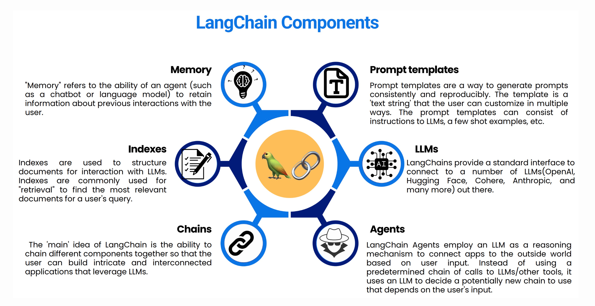
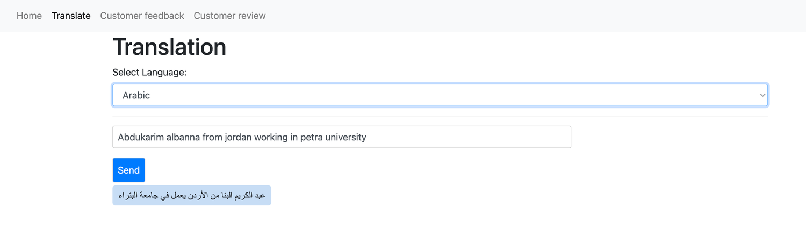
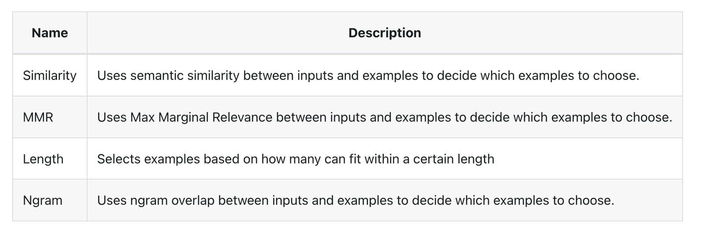
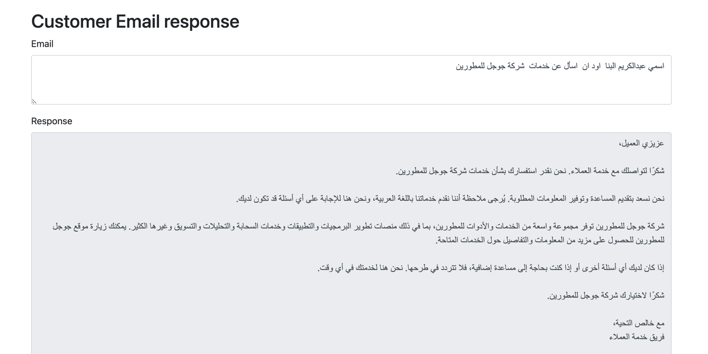
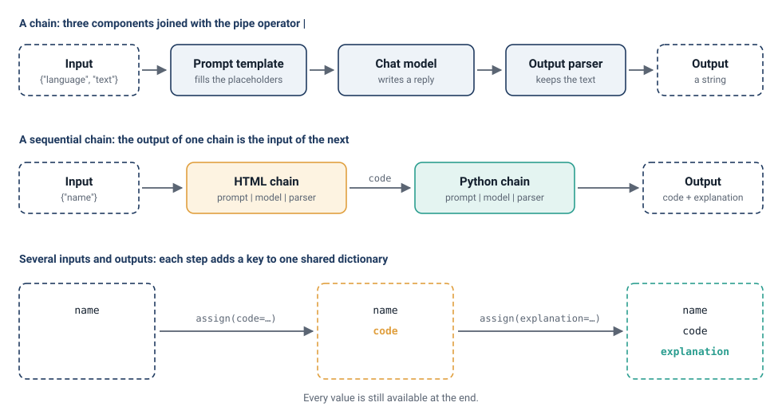
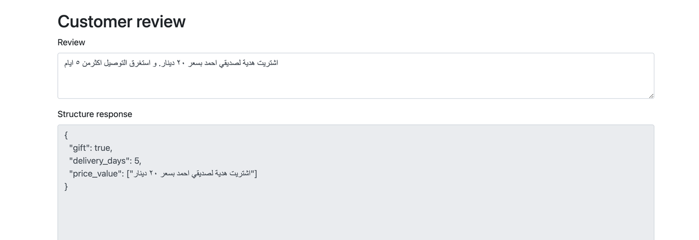
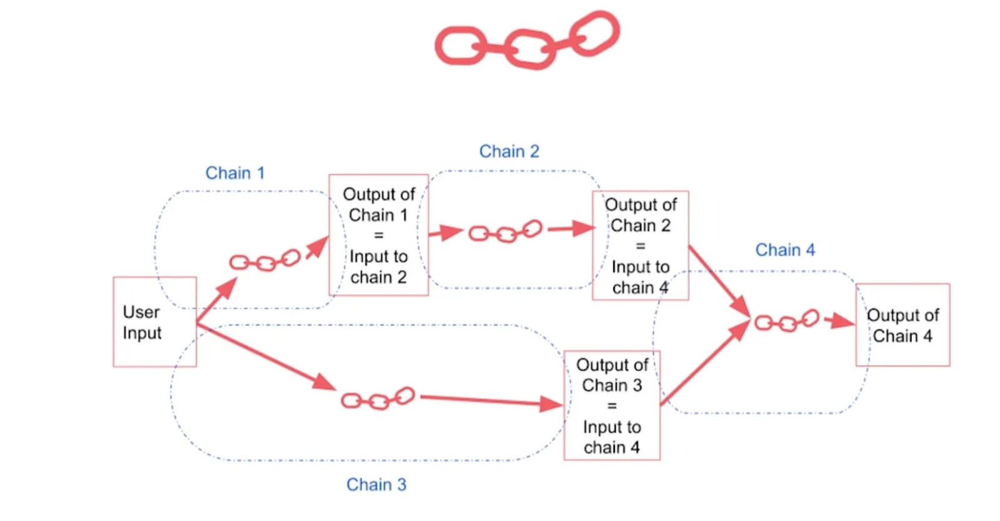
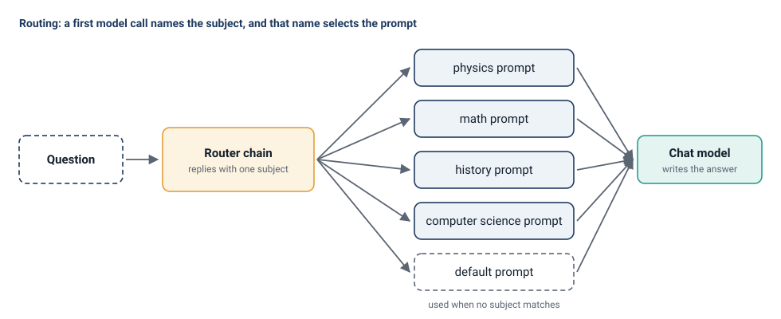
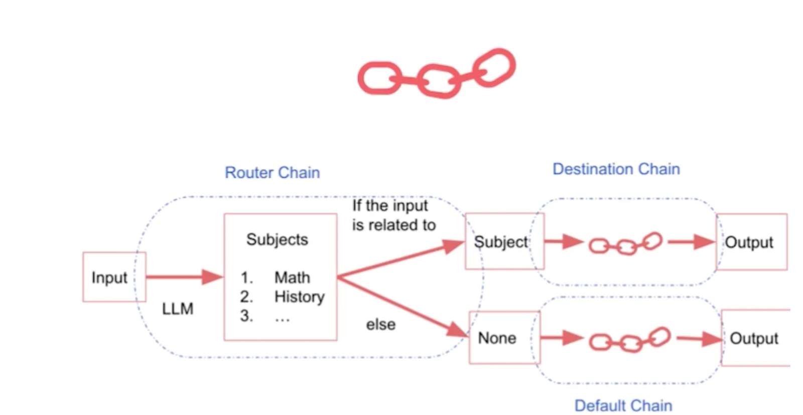

# LangChain: Prompts, Chains and Routing

*From one call to a model, to a program built around it.* Level: intermediate · about 75 minutes · LangChain 1.x, Hugging Face Transformers. The lesson follows the order of the course slides on LangChain and uses the current LangChain documentation for all code.

## What You'll Learn

By the end of this part you will be able to:

- Say what LangChain is, and name the packages it is divided into today
- Load a chat model that runs inside Google Colab without an API key
- Write a prompt template and fill it with values
- Join a prompt, a model and an output parser into a chain with the pipe operator `|`
- Turn a model's free text into a checked Python object
- Build a sequential chain, with one or with several inputs and outputs
- Route a question to the prompt that suits it

**Goal:** five small working programs (a translator, an email assistant, a review analyser, a two-step code generator and a subject router), which are the building blocks of the agents in your project.

**Prerequisites:** [Week 2](week02-text-classification.html) and [Week 3](week03-ner.html). You should be comfortable with Python dictionaries and functions, and with loading a model from the Hugging Face Hub.

### Abbreviations used in this lesson

| Abbreviation | Stands for | In one line |
|---|---|---|
| LLM | Large Language Model | A model that continues or answers text |
| API | Application Programming Interface | The way one program asks another for a service; here, a model that runs on a company's servers |
| LCEL | LangChain Expression Language | The notation that joins components with `|` |
| JSON | JavaScript Object Notation | A text format for structured data: `{"key": value}` |
| RAG | Retrieval-Augmented Generation | Finding relevant text first and giving it to the model with the question; the subject of the second part of this week |
| GPU, CPU | Graphics / Central Processing Unit | A language model answers much faster on a GPU |

## 1. What is LangChain?

A language model does one thing: it receives text and returns text. An application needs more than that. It must build the text that goes in, call the model, check what comes out, and often fetch documents or call other programs on the way. **LangChain** is an open-source Python framework for writing this surrounding program. It gives every kind of component (a prompt, a model, a parser, a document loader, a vector store) a standard interface, so that components can be joined together and exchanged for one another.

The practical benefit is exchange. In this lesson you will write each program once, with a small model that runs in Colab. If you later change one line to use a hosted model from OpenAI or Google, the remainder of the program stays as it is.

<figure class="fig wide"><figcaption>LangChain sits between the user, the models, and the places where information lives: documents and mail. Figure from Dr. Albanna&#x27;s course slides. The product logos are trademarks of their owners.</figcaption></figure>

<figure class="fig wide"><figcaption>The six kinds of component in LangChain. Figure from Dr. Albanna's course slides.</figcaption></figure>

> **Note: two names in this figure have changed.** The figure uses the vocabulary of 2023. What it calls **Indexes** is now described as *retrieval*: document loaders, text splitters, embedding models, vector stores and retrievers, which are the subject of the second part of this week. What it calls **LLMs** are now mostly **chat models**. If you look for an "Indexes" page in the current documentation, you will not find one.

This week covers four of the six components: prompt templates, models and chains in this part, and retrieval in the next. Agents are the subject of Weeks 5 and 9, and memory is treated in Week 5 with LangGraph.

### The packages

LangChain is installed as several packages. Knowing which package holds what makes the import lines in this lesson readable.

| Package | What it holds | Used in this lesson for |
|---|---|---|
| `langchain-core` | The basic interfaces: prompts, messages, output parsers, and the pipe operator | Almost every example |
| `langchain` | Agents and helpers for choosing a model (`create_agent`, `init_chat_model`) | The optional hosted model |
| `langchain-huggingface`, `langchain-openai`, … | One package per provider | The local chat model and the embedding model |
| `langchain-text-splitters` | Text splitters | Part 2 |
| `langchain-community` | Integrations maintained by the community, among them most document loaders | Part 2 |
| `langchain-classic` | The older chain classes, kept so that old programs still run | Not used |
| `langgraph` | Graphs of steps with state, loops and memory | Week 5 |

> **Careful: most LangChain code on the internet is written for an older version.** Tutorials from before LangChain 1.0 use classes such as `LLMChain` that have since moved out of the `langchain` package, so their import lines fail with `ModuleNotFoundError`. This lesson uses the current library throughout; if code you find elsewhere fails in this way, it is old, and the [migration guide](https://docs.langchain.com/oss/python/migrate/langchain-v1) shows what replaced it.

## 2. A Chat Model Without an API Key

The slides call OpenAI's models, which need an account, a key and payment. In this lesson the default model is **Qwen2.5-1.5B-Instruct**, an open model with about 1.5 billion parameters, published under the Apache 2.0 licence. It runs inside your own Colab session, so no registration is needed, and it understands Arabic as well as English.

Before you run the cell, choose **Runtime → Change runtime type → T4 GPU**. The code also works on a CPU, but each answer then takes far longer.

```python
import torch
from transformers import AutoModelForCausalLM, AutoTokenizer, pipeline
from langchain_huggingface import ChatHuggingFace, HuggingFacePipeline

MODEL_ID = "Qwen/Qwen2.5-1.5B-Instruct"

tokenizer = AutoTokenizer.from_pretrained(MODEL_ID)
model = AutoModelForCausalLM.from_pretrained(MODEL_ID)
if torch.cuda.is_available():
    model = model.half().to("cuda")          # half precision on the GPU: less memory, faster

generator = pipeline("text-generation", model=model, tokenizer=tokenizer,
                     max_new_tokens=300, do_sample=False, return_full_text=False)
llm = ChatHuggingFace(llm=HuggingFacePipeline(pipeline=generator))

print("Running on:", "GPU" if torch.cuda.is_available() else "CPU")
print(llm.invoke("In one sentence, what is LangChain?").content)
```

```code-notes
from_pretrained @2 :: Downloads the model's weights the first time (about 3 GB) and loads them into memory.
max_new_tokens=300 :: The longest reply the model may write, in tokens. A longer reply is cut off at this length.
do_sample=False :: Always choose the most probable next token, so the same question gives the same answer every time.
return_full_text=False :: Return only the new text, without repeating the prompt.
ChatHuggingFace :: Wraps the Hugging Face pipeline so that LangChain can use it like any other chat model.
llm.invoke :: Send one input to the model and wait for the whole reply.
```

The first run downloads the model, so allow a few minutes. The last line is your first LangChain call: `invoke` sends an input and returns a message object, whose text is in `.content`.

> **Terms: LLM and chat model.** An **LLM** in the older sense receives one string and continues it. A **chat model** receives a list of *messages*, each with a role, and returns one message. The roles are **system** (instructions for the whole conversation), **human** (what the user says) and **AI** (what the model replies). Almost every current model is a chat model, and LangChain's current interfaces are built for them. The variable is still named `llm` here, as in the slides and in most tutorials.

> **Note: what a small model can and cannot do.** A model of this size translates, summarises, rewrites and answers from a given text reasonably well. It is weaker than a large hosted model at following strict output formats, at long reasoning, and at writing longer programs. When an example in this lesson gives a poor answer, read the prompt that was sent before you conclude that the code is wrong: Section 3 shows how.

### Optional: a hosted model instead

If you have a key for a hosted model, two lines replace the local model, and every later example works unchanged. This is the exchange that Section 1 promised. The cell does nothing until you change `False` to `True`, so the notebook runs without a key.

```python
USE_HOSTED_MODEL = False          # change to True only if you have an API key

if USE_HOSTED_MODEL:
    # The key is read from Colab's Secrets panel (the key icon in the left bar), under the name OPENAI_API_KEY.
    # Model names change often: take a current name from the provider's own list.
    from langchain.chat_models import init_chat_model
    llm = init_chat_model("openai:gpt-4o-mini", temperature=0)
```

`init_chat_model` takes a string of the form `provider:model`. For Google's models the string begins with `google_genai:`, the package to install is `langchain-google-genai`, and the key is named `GOOGLE_API_KEY`.

## 3. Prompts

A **prompt** is the input that is passed to the model. The slides put it this way: prompts are the new way to program models. In an application the prompt is almost never a fixed sentence. It has a fixed part, written by the developer, and places for values that arrive at run time: the user's text, a language, a retrieved document. A **prompt template** holds the fixed part and names the places.

The first use case in the slides is a translation app: the user chooses a language, types a sentence and receives the translation.

<figure class="fig"><figcaption>The translation app from the course slides. Its whole logic is one prompt template with two placeholders. Screenshot from Dr. Albanna's course slides.</figcaption></figure>

```python
from langchain_core.prompts import ChatPromptTemplate

translate_prompt = ChatPromptTemplate.from_messages([
    ("system", "You are a translator. Translate the user's text into {language}. Reply with the translation only."),
    ("human", "{text}"),
])

messages = translate_prompt.format_messages(
    language="Arabic",
    text="Abdulkarim Albanna is from Jordan and works at the University of Petra.",
)
for m in messages:
    print(f"{m.type}: {m.content}")
print("Input variables:", translate_prompt.input_variables)
```

This cell does not call the model. It prints the messages that *would* be sent:

```text
system: You are a translator. Translate the user's text into Arabic. Reply with the translation only.
human: Abdulkarim Albanna is from Jordan and works at the University of Petra.
Input variables: ['language', 'text']
```

The template found the two placeholders, `{language}` and `{text}`, by itself. Now send the messages to the model:

```python
reply = llm.invoke(messages)
print(reply.content)
```

> **Tip: when a result is poor, print the prompt.** `format_messages` shows exactly what the model receives. Most problems in an LLM application are visible there: a placeholder that was filled with the wrong value, an instruction that is ambiguous, or a document that was never inserted.

> **Careful: a literal brace must be doubled.** The template treats everything between `{` and `}` as a placeholder. To show the model a real brace, for example in a JSON example, write `{{` and `}}`. A single brace gives a `KeyError` or an error about a missing variable.

### Few-shot examples and example selectors

A prompt can also teach by example. Showing the model a few solved cases before the real one is called **few-shot prompting**, and it is often the quickest way to fix the form of an answer. In a chat prompt each example is a pair of messages: a human message with the input, and an AI message with the answer you want.

```python
from langchain_core.prompts import FewShotChatMessagePromptTemplate

examples = [
    {"review": "The screen is sharp and the battery lasts two days.", "label": "positive"},
    {"review": "It stopped charging after a week.", "label": "negative"},
    {"review": "وصل الجهاز في موعده وهو يعمل جيدا.", "label": "positive"},
]
example_prompt = ChatPromptTemplate.from_messages([("human", "{review}"), ("ai", "{label}")])
few_shot = FewShotChatMessagePromptTemplate(example_prompt=example_prompt, examples=examples)

sentiment_prompt = ChatPromptTemplate.from_messages([
    ("system", "Classify the customer review as positive or negative. Reply with one word."),
    few_shot,
    ("human", "{review}"),
])

messages = sentiment_prompt.format_messages(review="The keyboard broke on the second day.")
for m in messages:
    print(f"{m.type}: {m.content}")
print("Model:", llm.invoke(messages).content)
```

The loop prints the prompt before the model is called. The three examples appear as a short conversation that has already taken place, and the real review is the last message:

```text
system: Classify the customer review as positive or negative. Reply with one word.
human: The screen is sharp and the battery lasts two days.
ai: positive
human: It stopped charging after a week.
ai: negative
human: وصل الجهاز في موعده وهو يعمل جيدا.
ai: positive
human: The keyboard broke on the second day.
```

With three examples, all of them can go into every prompt. With three hundred they cannot, and most would be irrelevant to any one input. An **example selector** chooses, for each input, which examples to include. The slides list four kinds.

<figure class="fig wide"><figcaption>The four kinds of example selector. Table from Dr. Albanna&#x27;s course slides, after the LangChain documentation.</figcaption></figure>

> **Note: two of these selectors are retrieval in miniature.** The *Similarity* and *MMR* selectors embed the examples, store the vectors, and pick the examples closest to the input. That is the mechanism of the second part of this week, applied to examples instead of documents. Three of the four classes are in `langchain_core.example_selectors`; the n-gram selector is in `langchain_community`.

### The email assistant

The second use case answers a customer's email in the customer's language. Only the system message changes; the code has the same shape. The template is reusable: the same object serves every email and every language.

<figure class="fig"><figcaption>The customer email app from the course slides, with an Arabic email and the generated reply. Screenshot from Dr. Albanna's course slides.</figcaption></figure>

```python
email_prompt = ChatPromptTemplate.from_messages([
    ("system", "You work in customer service for a software company. Write a short, polite reply "
               "to the customer's email. Write the reply in {language}."),
    ("human", "{email}"),
])

messages = email_prompt.format_messages(
    language="Arabic",
    email="اسمي عبدالكريم البنا، أود أن أسأل عن خدمات الشركة للمطورين.",
)
print(llm.invoke(messages).content)
```

## 4. Chains and the Pipe Operator

In Section 3 two steps were written by hand: fill the template, then call the model. A **chain** joins such steps so that the output of each becomes the input of the next. In current LangChain a chain is written with the pipe operator `|`, a notation called the LangChain Expression Language (<abbr data-tip="LangChain Expression Language: the notation that joins components with |" tabindex="0">LCEL</abbr>).

<figure class="fig"><figcaption>A chain: each link holds the next. Photograph from Dr. Albanna&#x27;s course slides.</figcaption></figure>

<figure class="fig wide"><figcaption>The three chain shapes of this lesson: a single chain (this section), a sequential chain, and a chain with several inputs and outputs (Section 6).</figcaption></figure>

```python
from langchain_core.output_parsers import StrOutputParser

translate_chain = translate_prompt | llm | StrOutputParser()

print(translate_chain.invoke({"language": "French", "text": "Good morning, how are you?"}))
```

Read the first line from left to right. The dictionary given to `invoke` goes into the prompt template, which produces messages. The messages go into the model, which produces a message. That message goes into `StrOutputParser`, which keeps its text. The chain as a whole receives a dictionary and returns a string.

Every chain has the same three methods, whatever it contains:

```python
# batch: several inputs in one call
results = translate_chain.batch([
    {"language": "German", "text": "Where is the library?"},
    {"language": "Spanish", "text": "Where is the library?"},
])
print(results)

# stream: receive the reply piece by piece, as a chat window shows it
for piece in translate_chain.stream({"language": "Arabic", "text": "The lecture starts at ten."}):
    print(piece, end="", flush=True)
```

> **Terms: Runnable.** Anything that can stand on either side of `|` is called a **Runnable**: a prompt template, a model, a parser, a retriever, or a whole chain. All of them offer `invoke`, `batch` and `stream`. Because a chain is itself a Runnable, chains can be joined into larger chains, which is what Sections 6 and 7 do.

## 5. Structured Output

The third use case in the slides reads a customer review and extracts three facts from it: whether the item was a gift, how many days the delivery took, and what the customer said about the price. A program that receives this answer cannot work with a paragraph. It needs a Python object with three fields.

<figure class="fig"><figcaption>The review app from the course slides: free text goes in and a JSON object with three keys comes out. Screenshot from Dr. Albanna's course slides.</figcaption></figure>

The method has three steps: describe the object you want, tell the model to answer in that form, and parse the answer. The description is a **Pydantic** class, which is a Python class whose fields have types that are checked.

```python
from pydantic import BaseModel, Field
from langchain_core.output_parsers import PydanticOutputParser

class Review(BaseModel):
    gift: bool = Field(description="Was the item bought as a gift for someone else?")
    delivery_days: int = Field(description="Number of days the delivery took; -1 if the review does not say")
    price_value: list[str] = Field(description="Sentences or phrases about the price or the value of the item")

parser = PydanticOutputParser(pydantic_object=Review)
```

The parser does two jobs. The first is to write the instruction for the model. Print it:

```python
print(parser.get_format_instructions())
```

The output is a paragraph that asks for JSON and gives the schema of the three fields, built from the class above. The second job is to turn the model's reply into a `Review` object. You can try that without the model:

```python
review = parser.parse('{"gift": true, "delivery_days": 5, "price_value": ["بسعر ٢٠ دينار"]}')
print(review)
print(review.delivery_days + 1)      # a real integer, not the text "5"
```

```text
gift=True delivery_days=5 price_value=['بسعر ٢٠ دينار']
6
```

Now build the chain. The format instructions are a value that never changes, so they are fixed in the template once, with `partial`.

```python
review_prompt = ChatPromptTemplate.from_messages([
    ("system", "Extract information from the customer review.\n{format_instructions}"),
    ("human", "{review}"),
]).partial(format_instructions=parser.get_format_instructions())

review_chain = review_prompt | llm | parser

from langchain_core.exceptions import OutputParserException

try:
    result = review_chain.invoke({"review": "اشتريت هدية لصديقي أحمد بسعر ٢٠ دينار، واستغرق التوصيل أكثر من ٥ أيام."})
    print(result)
    print("Gift?", result.gift, "| Days:", result.delivery_days)
except OutputParserException as error:
    print("The model's reply did not fit the Review class:\n", error)
```

The review says: "I bought a gift for my friend Ahmad for 20 dinars, and the delivery took more than 5 days."

> **Careful: the parser checks the answer; it does not force it.** The instruction asks the model for JSON, and a small model does not always obey. It may add a sentence before the JSON or leave a field out. The parser then raises an `OutputParserException` whose message shows the text that the model wrote, and the cell above catches it and prints it. This is the correct behaviour: a program should notice a malformed answer, not continue with wrong data. To see the raw reply on its own, run the chain without its last step: `(review_prompt | llm | StrOutputParser()).invoke(...)`.

### With a hosted model: `with_structured_output`

Large hosted models have a built-in way of returning structured data, and the current documentation recommends it. The model is given the class directly; no format instructions and no parser are needed.

```python-note
# Works with hosted chat models (OpenAI, Google, Anthropic and others)
structured_llm = llm.with_structured_output(Review)
result = structured_llm.invoke("I bought it as a gift for my friend. It arrived after 5 days and was worth the 20 dinars.")
```

> **Note: why this lesson uses the parser.** The local Hugging Face wrapper does not support this method for a Pydantic class: the call raises `NotImplementedError`. The parser method works with every model, because it relies only on text going in and text coming out. It is also the method of the course slides, so nothing is lost by learning it first.

## 6. Sequential Chains

A **sequential chain** runs chains one after another: the output of one is the input of the next. The slides distinguish two kinds, one with a single input and output, and one with several.

The example from the slides has two steps. The first model call writes an HTML page for a small program that teaches children programming. The second receives that HTML, converts it into Python and explains it.

```python
html_prompt = ChatPromptTemplate.from_template(
    "You are a web developer. Write a short HTML page for a program that teaches children "
    "programming. The program is: {name}. Reply with the HTML code only."
)
python_prompt = ChatPromptTemplate.from_template(
    "You are a Python developer. Convert the following HTML page into a short Python program "
    "that does the same job, then explain the program in three sentences.\n\n{code}"
)

html_chain = html_prompt | llm | StrOutputParser()
python_chain = python_prompt | llm | StrOutputParser()

overall_chain = {"code": html_chain} | python_chain

print(overall_chain.invoke({"name": "add two numbers"}))
```

The line that joins the two chains is `{"code": html_chain} | python_chain`. A dictionary on the left of `|` means: run each value, and put the result under its key. Here `html_chain` runs, and its output becomes the value of `code`, which is the placeholder that `python_prompt` expects.

This chain makes two model calls, each of up to 300 tokens, so it is the slowest example of the lesson. On a CPU it can take a few minutes.

### Several inputs and outputs

The chain above returns only the final text; the HTML is lost on the way. To keep every intermediate result, let each step *add* a key to one dictionary, with `RunnablePassthrough.assign`.

```python
from langchain_core.runnables import RunnablePassthrough

full_chain = (
    RunnablePassthrough.assign(code=html_chain)
    | RunnablePassthrough.assign(explanation=python_chain)
)

result = full_chain.invoke({"name": "add two numbers"})
print(result.keys())
print(result["code"][:300])
```

`result` is a dictionary with three keys: `name`, which you supplied, and `code` and `explanation`, which the two steps added. A later step can use any of them: a third prompt could contain both `{name}` and `{code}`.

The slides draw the general case: four chains, in which one user input feeds two chains, and the last chain receives the outputs of two earlier ones. Each arrow in the picture is one key of the shared dictionary.

<figure class="fig wide"><figcaption>A sequential chain with several inputs and outputs. Figure from Dr. Albanna&#x27;s course slides.</figcaption></figure>

## 7. Routing

Sometimes one prompt cannot serve every input. A physics question is answered best by a prompt that speaks as a physics teacher, and a history question by another. **Routing** means sending each input to the chain that suits it.

<figure class="fig wide"><figcaption>Routing. The model is called twice: once to name the subject, and once to answer with the prompt chosen for that subject.</figcaption></figure>

The current form needs three pieces: the destination prompts, a small chain that names the subject, and a function that picks the prompt.

```python
teacher = {
    "physics": "You are a physics professor. Explain concisely and name the law or principle involved.",
    "math": "You are a mathematician. Break the problem into steps and solve them in order.",
    "history": "You are a historian. Give dates and causes, and say how certain the evidence is.",
    "computer science": "You are a computer scientist. Explain the idea, then give its time and space cost.",
}
subject_prompts = {
    subject: ChatPromptTemplate.from_messages([("system", instruction), ("human", "{input}")])
    for subject, instruction in teacher.items()
}
default_prompt = ChatPromptTemplate.from_messages([("human", "{input}")])

router_prompt = ChatPromptTemplate.from_template(
    "Which subject does this question belong to? Choose one of: physics, math, history, "
    "computer science, other. Reply with the subject only.\n\nQuestion: {input}"
)
router_chain = router_prompt | llm | StrOutputParser()

print(router_chain.invoke({"input": "What is black body radiation?"}))
```

The last line tests the router alone. It should print one subject. Now the function that turns that word into a prompt, and the whole chain:

```python
from langchain_core.runnables import RunnableLambda

def pick_prompt(info):
    subject = info["subject"].strip().lower()
    for name, prompt in subject_prompts.items():
        if name in subject:
            return prompt
    return default_prompt                      # no subject matched

routed_chain = (
    RunnablePassthrough.assign(subject=router_chain)
    | RunnableLambda(pick_prompt)
    | llm
    | StrOutputParser()
)

for question in ["What is black body radiation?",
                 "What are greedy algorithms?",
                 "What should I cook for dinner?"]:
    print("Q:", question)
    print("A:", routed_chain.invoke({"input": question}), "\n")
```

Follow one question through the chain. `assign` adds the key `subject` to the dictionary, using the router. `pick_prompt` receives the dictionary and returns one of the prompt templates. When a function inside a chain returns a Runnable, LangChain runs that Runnable on the same input, so the chosen prompt is filled with the question. The model then answers.

> **Careful: the router's reply is text, and text is untidy.** The model may reply `Physics`, `physics.` or `The subject is physics`. The function therefore lowers the case and tests whether a subject name occurs *in* the reply, where an exact comparison would fail. The third question matches no subject and falls through to the default prompt. Always give a router a default.

The slides draw the same design and name its three parts: the *router chain*, which is `router_chain` above; the *destination chains*, which are the subject prompts followed by the model; and the *default chain*, which is `default_prompt` followed by the model.

<figure class="fig wide"><figcaption>Router chain, destination chains and default chain. Figure from Dr. Albanna&#x27;s course slides.</figcaption></figure>

In Week 5 the same idea returns in LangGraph, where the function that chooses the next step is called a *conditional edge*.

## 8. From the Lesson to Your Project

The project milestone for this week asks for a prompt template for each agent. The patterns of this part are the ones you need: a system message that states the agent's role (Section 3), a Pydantic class wherever another agent or program must read the result (Section 5), and a router wherever the pipeline has to choose a path (Section 7). The requirements themselves are on the [project page](project.html).

## 9. Check Your Understanding

<details markdown="1">
<summary>1. What are the three parts of the simplest chain, and what does each one receive and return?</summary>

A prompt template receives a dictionary and returns messages. A chat model receives messages and returns one message. An output parser receives that message and returns a Python value, in the simplest case a string.
</details>

<details markdown="1">
<summary>2. In a few-shot chat prompt, how is one example represented, and why would you use an example selector?</summary>

One example is a pair of messages: a human message with the input and an AI message with the wanted answer. An example selector is used when there are too many examples to place in every prompt: it chooses, for each input, the few that are most useful, for instance the most similar ones.
</details>

<details markdown="1">
<summary>3. Your template contains a JSON example, and filling it raises an error about a missing variable. Why?</summary>

The braces of the JSON example are read as placeholders. Literal braces in a template must be doubled: `{{` and `}}`.
</details>

<details markdown="1">
<summary>4. What are the two jobs of <code>PydanticOutputParser</code>?</summary>

It writes the format instructions that are placed in the prompt, and it converts the model's reply into an object of the given class, raising an error if the reply does not fit.
</details>

<details markdown="1">
<summary>5. The review chain raises <code>OutputParserException</code>. Is the code wrong? What do you do first?</summary>

Not necessarily. The exception means that the model's reply was not valid JSON for the class. Look at the raw reply first, by running the chain without the parser. Then make the instruction stricter, shorten the review, or use a stronger model.
</details>

<details markdown="1">
<summary>6. What is the difference between <code>{"code": html_chain} | python_chain</code> and the version with <code>RunnablePassthrough.assign</code>?</summary>

Both run the two chains in order. The first returns only the final text. The second returns a dictionary that still contains the original input and every intermediate result.
</details>

<details markdown="1">
<summary>7. How many times is the model called for one question in the routed chain, and why does the router need a default?</summary>

Twice: once to name the subject and once to answer. The default is needed because some questions belong to none of the listed subjects, and because the router's reply is free text that may match nothing.
</details>

## 10. Summary and Further Reading

**What you learned:** LangChain gives prompts, models and parsers one interface, so that they can be joined with `|` and exchanged for one another. A prompt template separates the fixed instruction from the values that arrive at run time. An output parser turns free text into a checked object. Chains can be placed in sequence, can carry a dictionary that grows at each step, and can choose their next step from the model's own reply.

**Further reading**

- LangChain documentation: https://docs.langchain.com/oss/python/langchain/overview
- LangChain v1 migration guide, for updating older code: https://docs.langchain.com/oss/python/migrate/langchain-v1
- Chat models in LangChain: https://docs.langchain.com/oss/python/langchain/models
- Structured output: https://docs.langchain.com/oss/python/langchain/structured-output
- Hugging Face chat models in LangChain: https://docs.langchain.com/oss/python/integrations/chat/huggingface
- Qwen2.5-1.5B-Instruct, the model used in this lesson: https://huggingface.co/Qwen/Qwen2.5-1.5B-Instruct

**Figure credits.** The components figure, the three app screenshots, the example-selector table, and the figures of LangChain's connections, of chains with several inputs and outputs, and of the router chain, and the photograph of a chain, come from Dr. Abdulkarim Albanna's course slides. The first chain diagram and the first routing diagram were drawn for this lesson. Product logos that appear in the figures are trademarks of their owners.

## Test code

### A chain without a model: see what each step produces

```python
from langchain_core.prompts import ChatPromptTemplate
from langchain_core.messages import AIMessage
from langchain_core.runnables import RunnableLambda
from langchain_core.output_parsers import StrOutputParser

prompt = ChatPromptTemplate.from_messages([
    ("system", "You are a helpful assistant."),
    ("human", "Summarize {text} for a {audience}."),
])
echo_model = RunnableLambda(lambda p: AIMessage(content=f"(the model received {len(p.to_messages())} messages)"))

chain = prompt | echo_model | StrOutputParser()
print(prompt.input_variables)
print(chain.invoke({"text": "the LangChain packages", "audience": "first-year student"}))
```

### Parse a model's JSON reply into a checked object

```python
from pydantic import BaseModel, Field
from langchain_core.output_parsers import PydanticOutputParser

class Source(BaseModel):
    title: str = Field(description="Title of the source")
    year: int = Field(description="Year of publication")
    relevant: bool = Field(description="Is the source relevant to the research topic?")

parser = PydanticOutputParser(pydantic_object=Source)
print(parser.parse('{"title": "Attention Is All You Need", "year": 2017, "relevant": true}'))
```
