# Chat with Your Documents (RAG)

*Give the model the right page before you ask the question.* Level: intermediate · about 90 minutes · LangChain 1.x, Sentence-Transformers. The concepts follow Tunstall, von Werra & Wolf, *Natural Language Processing with Transformers* (Revised Edition, 2022), Chapter 7, "Question Answering", and the worked example uses the same customer reviews as that chapter.

## What You'll Learn in This Part

By the end of this part you will be able to:

- Explain why a language model alone cannot answer questions about private or recent documents
- Describe the retriever-reader architecture, and how <abbr data-tip="Retrieval-Augmented Generation: finding relevant text first and giving it to the model with the question" tabindex="0">RAG</abbr> grew out of it
- Load documents, split them into chunks, embed the chunks and store them in a vector store
- Choose a chunk size with the limits of the embedding model in mind
- Build a chain that retrieves the relevant chunks and answers from them
- Measure a retriever with recall at *k*, as the textbook does
- Say when a fixed RAG chain is enough and when an agent is the better design

**Goal:** a working question-answering system over 56 real customer reviews, which you can question, measure and then point at your own documents.

**Prerequisites:** the first part of this week. The examples continue in the same notebook and use its `llm`, `ChatPromptTemplate`, `StrOutputParser` and `RunnablePassthrough`.

### Abbreviations used in this part

| Abbreviation | Stands for | In one line |
|---|---|---|
| RAG | Retrieval-Augmented Generation | Finding relevant text first and giving it to the model with the question |
| QA | Question Answering | The task of answering a question from text |
| BM25 | Best Match 25 | A classical search method that scores documents by the words they share with the query |
| DPR | Dense Passage Retrieval | Retrieval with two BERT encoders, one for questions and one for passages |
| ANN | Approximate Nearest Neighbour | A fast search for the vectors closest to a given vector, which accepts a small loss of accuracy |
| PDF | Portable Document Format | The usual file format of reports and papers |

## 1. Why a Model Alone Is Not Enough

Suppose a company wants a chatbot that answers questions about its own documents. The first idea is to send each question directly to a commercial model such as ChatGPT. The course slides give three reasons why this fails.

<figure class="fig">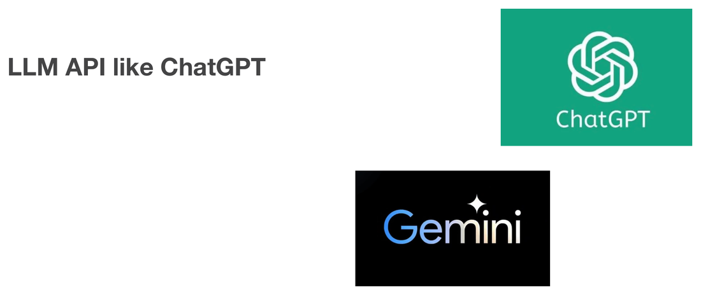<figcaption>The first idea: ask a commercial model directly. Figure from Dr. Albanna&#x27;s course slides. The product logos are trademarks of their owners.</figcaption></figure>

- **The model has not seen your documents.** It was trained on text that was public at one moment in the past. Internal documents were never in that text, and documents written after that moment could not be.
- **The model knows a great deal that is irrelevant.** Its training data contains far more unrelated context than context for your question.
- **The model fills gaps with invention.** Asked about something it has not seen, a language model can produce a fluent answer that is false. This is called *hallucination*.

<figure class="fig">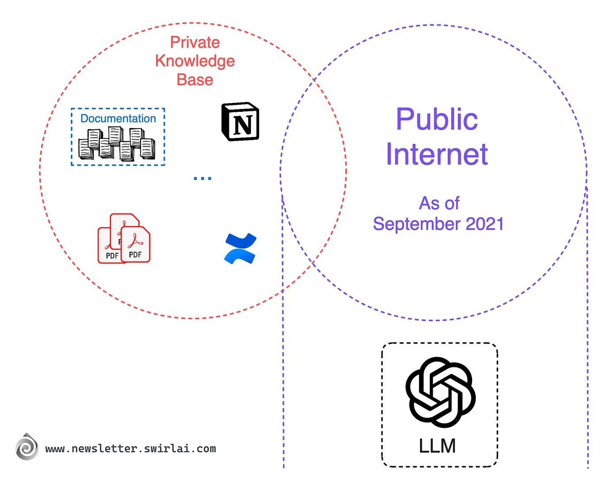<figcaption>What the model was trained on, and what your question is about, are two different sets. The date is that of the model on the 2024 slide; every model has such a date. Figure from Dr. Albanna&#x27;s course slides; originally from the SwirlAI Newsletter (newsletter.swirlai.com).</figcaption></figure>

The second idea is to put the documents into the prompt: write the question, paste the whole knowledge base beside it, and instruct the model to answer from that text only. This works for one short document. For a real knowledge base it meets a limit: every model has a **context window**, a maximum number of tokens that it can read at once.

<figure class="fig wide">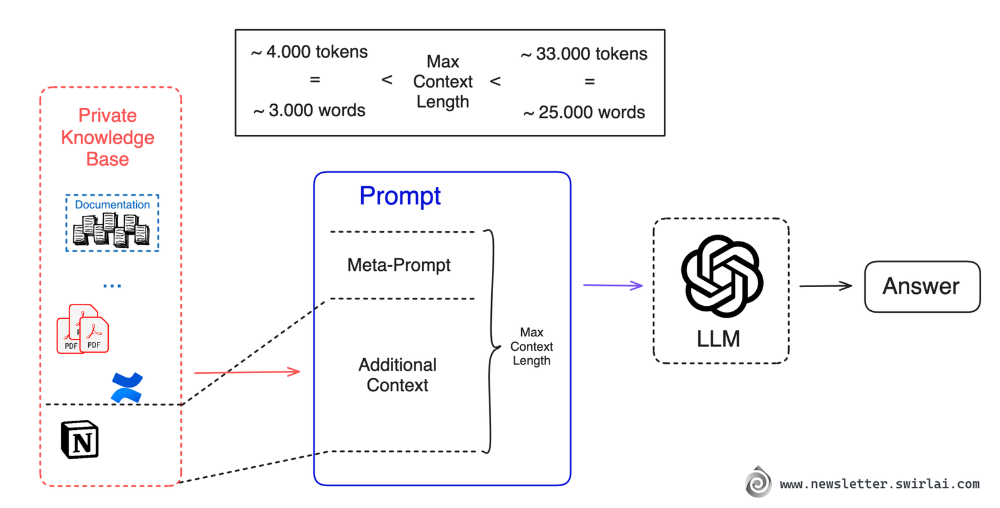<figcaption>The second idea: put the knowledge base into the prompt. The prompt cannot be longer than the context length. Figure from Dr. Albanna&#x27;s course slides; originally from the SwirlAI Newsletter (newsletter.swirlai.com).</figcaption></figure>

> **Note: the numbers on the slides have changed, and the argument has not.** The slides, written in January 2024, give context windows of about 4,000 to 33,000 tokens, with 1,000 tokens equal to roughly 750 words. Windows have grown since then: the small model of this lesson accepts 32,768 tokens, and large hosted models accept far more. Three costs remain. A company's documents are still larger than any window. Every token in the prompt costs time and, with a hosted model, money, on every single question. And a model answers less accurately when the passage it needs is buried in a long, mostly irrelevant prompt. The textbook makes the same point with a calculation: if a product has 30 reviews and each takes 100 milliseconds to process, reading all of them costs 3 seconds for every question.

The solution is to send the model only the few passages that bear on the question. Finding those passages is called **retrieval**, and the whole method is **retrieval-augmented generation**: the model's generation is augmented with retrieved text. RAG gives a model new knowledge without training it again, which is why the slides call it cost-efficient: the same model serves new data as soon as the data is indexed.

## 2. From Retriever-Reader to RAG

RAG did not appear from nowhere. Chapter 7 of the textbook builds a question-answering system over product reviews and arrives at RAG in its last section. The path it takes explains the design.

The starting point is the **retriever-reader architecture**. A **retriever** selects, from all documents, the few that are relevant to the question. A **reader** then extracts the answer from those few.

<figure class="fig">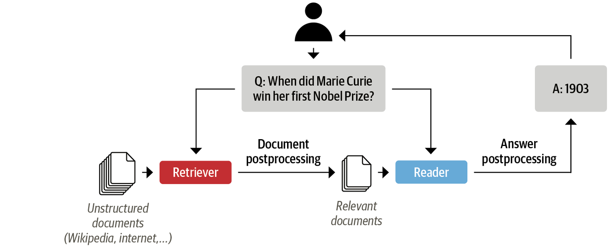<figcaption>The retriever-reader architecture. Figure from the companion repository of Tunstall et al. (2022), Apache 2.0 licence.</figcaption></figure>

Retrievers come in two kinds.

- A **sparse retriever** represents each document by the words it contains and scores documents by the words they share with the query. <abbr data-tip="Best Match 25: a classical search method that scores documents by the words they share with the query" tabindex="0">BM25</abbr> is the standard example. It is fast and needs no training, but it finds nothing when the question and the answer use different words.
- A **dense retriever** turns the query and each document into an embedding, a vector that encodes meaning, and scores documents by the similarity of the vectors. It can match *"Is it good for reading?"* with a review that says *"I use it for books every night"*, although the two share almost no words.

The textbook's dense retriever is <abbr data-tip="Dense Passage Retrieval: retrieval with two BERT encoders, one for questions and one for passages" tabindex="0">DPR</abbr>, which uses two BERT encoders: one for questions and one for passages.

<figure class="fig">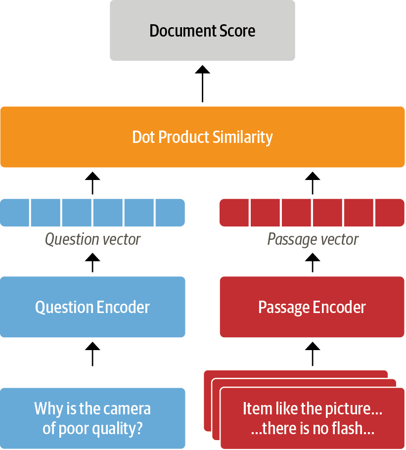<figcaption>The bi-encoder of Dense Passage Retrieval: the question and the passage are encoded separately, and their dot product is the relevance score. Figure from the companion repository of Tunstall et al. (2022), Apache 2.0 licence.</figcaption></figure>

> **Note: dense is not automatically better.** In the textbook's experiment, BM25 reached almost perfect recall once it returned ten documents, and DPR gave no improvement in recall over it. Dense retrieval helps most when users phrase things differently from the documents. Many production systems combine both kinds.

The reader of the textbook is *extractive*: it marks a span of words inside a retrieved document, as the NER model of Week 3 marked entities. Its answer can therefore only be a phrase that already stands in one document. **RAG**, introduced by Lewis et al. (2020), replaces the reader with a *generator*: a language model that writes the answer in its own words, and can combine evidence from several passages.

<figure class="fig">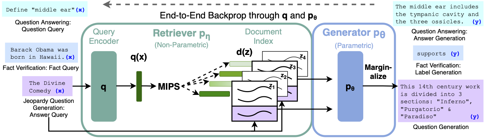<figcaption>The RAG architecture of Lewis et al. (2020), in which retriever and generator are fine-tuned together. Figure courtesy of Ethan Perez, from the companion repository of Tunstall et al. (2022), Apache 2.0 licence.</figcaption></figure>

> **Careful: "RAG" names two different things.** In the original paper, and in this figure, the retriever and the generator are *trained together*: the dashed arrow is the training signal flowing through both. What industry calls RAG today, and what you build in this lesson, has **no training at all**. A ready-made embedding model retrieves, a ready-made chat model generates, and a prompt joins them. The idea is the same; the engineering is far simpler.

## 3. The Pipeline: Index Once, Answer Many Times

A RAG system works in two phases. **Indexing** happens once, before any question is asked: the documents are loaded, split, embedded and stored. **Retrieval and generation** happen for every question.

<figure class="fig">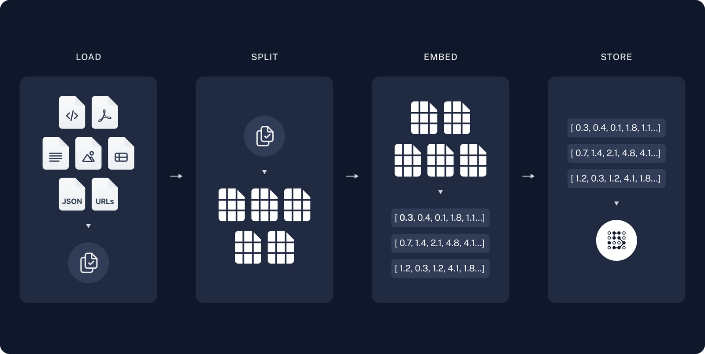<figcaption>Phase one, indexing: load, split, embed, store. Figure from the LangChain documentation, MIT licence.</figcaption></figure>

<figure class="fig">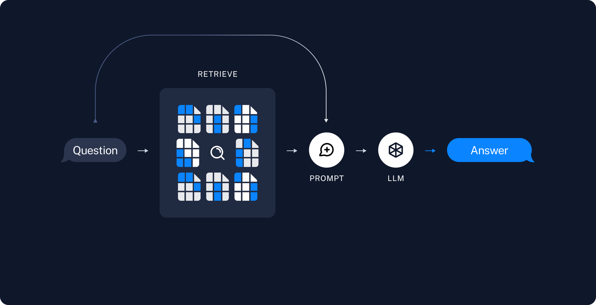<figcaption>Phase two, for every question: retrieve, build the prompt, generate. Figure from the LangChain documentation, MIT licence.</figcaption></figure>

The course slides list the same pipeline as nine steps.

*Indexing*

1. **Split** the text of the whole knowledge base into chunks. A chunk is one piece of context that can be retrieved.
2. **Embed** each chunk: an embedding model turns it into a vector.
3. **Store** all the vectors in a vector database.
4. **Save** the text of each chunk with a pointer to its vector.

*Answering a question*

5. **Embed** the question with the *same* embedding model.
6. **Query** the vector database with the question's vector.
7. The database performs an **approximate nearest neighbour** (<abbr data-tip="Approximate Nearest Neighbour: a fast search for the vectors closest to a given vector, which accepts a small loss of accuracy" tabindex="0">ANN</abbr>) search and returns the closest vectors.
8. **Map** the returned vectors back to the text chunks they stand for.
9. **Pass** the question and the retrieved chunks to the model in one prompt.

The slides also show all nine steps in one diagram. Follow the circled numbers.

<figure class="fig wide">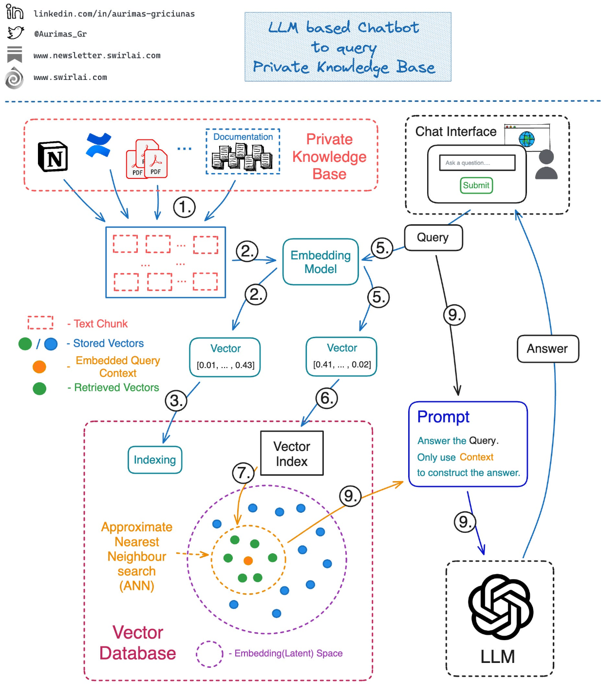<figcaption>All nine steps of a chatbot over a private knowledge base. Figure from Dr. Albanna&#x27;s course slides; originally from the SwirlAI Newsletter (newsletter.swirlai.com).</figcaption></figure>

<figure class="fig">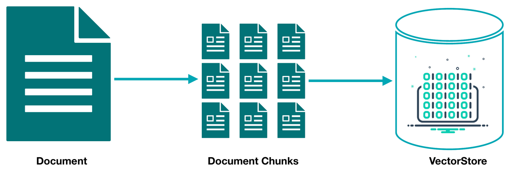<figcaption>Indexing in one picture: document, chunks, vector store. Figure from Dr. Albanna's course slides.</figcaption></figure>

<figure class="fig">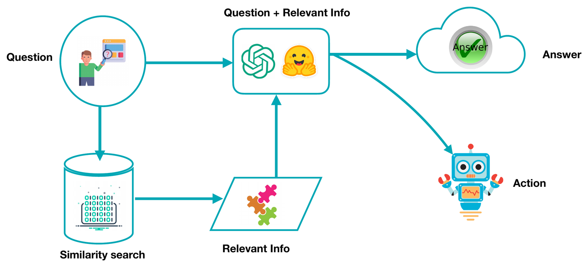<figcaption>Answering in one picture: the question triggers a similarity search, and the model receives the question together with what was found. Figure from Dr. Albanna's course slides.</figcaption></figure>

Before writing the code, watch the whole pipeline once in the animation:

{{display: rag}}

The following sections build each stage in turn. The data is the one the textbook uses: **SubjQA**, a collection of customer reviews with questions about them. From its electronics part we take the reviews of a single product, a tablet computer, and ask the textbook's own question: *"Is it good for reading?"*

## 4. Step 1: Load

A **document loader** reads data from a source and returns it in one standard form. Whatever the source is (a PDF, a web page, a spreadsheet, a chat export), the result is a list of **`Document`** objects. A `Document` has two parts: `page_content`, the text, and `metadata`, a dictionary that records where the text came from.

<figure class="fig wide">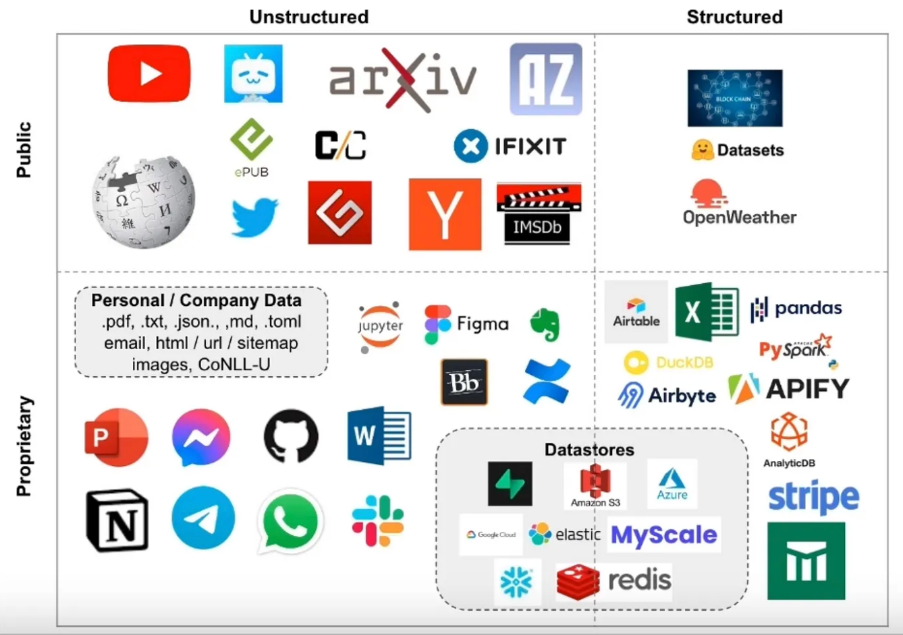<figcaption>The kinds of source for which LangChain has document loaders: public or proprietary, unstructured or structured. Figure from Dr. Albanna's course slides; originally from the DeepLearning.AI short course "LangChain: Chat with Your Data".</figcaption></figure>

The reviews are in a CSV file, so pandas reads them, and each review becomes a `Document`.

```python
import pandas as pd
from langchain_core.documents import Document

BASE = "https://raw.githubusercontent.com/megagonlabs/SubjQA/master/SubjQA/electronics/splits/"
subjqa = pd.concat([pd.read_csv(BASE + f"{split}.csv") for split in ("train", "dev", "test")])

tablet = subjqa[subjqa["item_id"] == "B0074BW614"]          # the product used in the textbook
reviews = tablet.drop_duplicates("review_id")

docs = [
    Document(page_content=row.review.replace("ANSWERNOTFOUND", "").strip(),
             metadata={"review_id": row.review_id, "item_id": row.item_id})
    for row in reviews.itertuples()
]

print("Rows in the electronics data:", len(subjqa), "| different reviews:", subjqa["review_id"].nunique())
print("Reviews of the tablet:", len(docs))
print(docs[0].page_content[:300])
print(docs[0].metadata)
```

```text
Rows in the electronics data: 3324 | different reviews: 1615
Reviews of the tablet: 56
```

The data has one row for every question, and several questions can refer to the same review, so the duplicates are dropped. The 1,615 different reviews are the same count that the textbook reports after loading its document store. The marker `ANSWERNOTFOUND` at the end of each review belongs to the dataset's format, so it is removed.

> **Tip: always keep metadata.** The `review_id` costs nothing to store. Without it you can never show a user where an answer came from, and you cannot measure the retriever (Section 9).

### Loading a PDF and a web page

Your project's sources will mostly be PDF files and web pages. The slides name the loaders for both. Each returns the same `Document` objects, so everything after this step is unchanged.

```python
import os
os.environ.setdefault("USER_AGENT", "606363-course-notebook")   # a web client should name itself
from langchain_community.document_loaders import PyPDFLoader, WebBaseLoader

# The RAG paper of Lewis et al. (2020), and this course's syllabus page
PDF_SOURCE = "https://arxiv.org/pdf/2005.11401"
WEB_SOURCE = "https://zmomani.github.io/ComputingSystemsDS-AI/lessons/syllabus.html"

pdf_pages = PyPDFLoader(PDF_SOURCE).load()                      # one Document per page
first = pdf_pages[0]
print(len(pdf_pages), "pages |", first.metadata.get("source"), "| page", first.metadata.get("page"))
print(first.page_content[:200])

web_docs = WebBaseLoader(WEB_SOURCE).load()                     # one Document for the whole page
print(len(web_docs[0].page_content), "characters from", web_docs[0].metadata.get("source"))
```

`PyPDFLoader` also accepts the path of a file that you have uploaded to Colab. The slides mention a third loader, for YouTube videos. It first transcribes the audio with a speech model, which takes minutes and a further download, so it is not run here.

## 5. Step 2: Split

A review can be thousands of characters long, and a report can be hundreds of pages. Retrieval works on smaller pieces, called **chunks**, for two reasons. A small chunk about one topic matches a question more precisely than a long text about ten. And the embedding model of the next step can only read a limited length.

Splitting is, in the words of the slides, important and tricky: the pieces must stay meaningful. Two splitters are compared there.

- **`CharacterTextSplitter`** splits at one separator, by default a blank line, and then joins the pieces into chunks.
- **`RecursiveCharacterTextSplitter`** tries a list of separators in order: paragraphs first, then lines, then words, then single characters. It moves to a finer separator only when a piece is still too large.

Both have two settings. **`chunk_size`** is the maximum length of a chunk in characters. **`chunk_overlap`** is the number of characters that the end of one chunk shares with the start of the next, so that a sentence cut at a border still appears whole in one of the two.

<figure class="fig wide">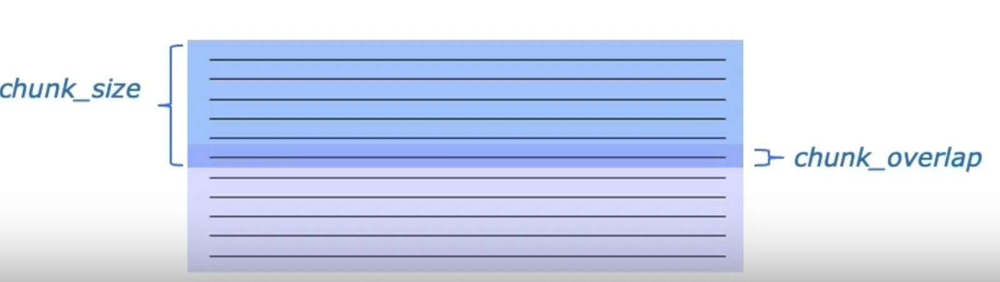<figcaption>Chunk size and chunk overlap. Figure from Dr. Albanna&#x27;s course slides; originally from the DeepLearning.AI short course "LangChain: Chat with Your Data".</figcaption></figure>

The slides demonstrate the settings with very small numbers, so that the effect can be read off directly.

```python
from langchain_text_splitters import CharacterTextSplitter, RecursiveCharacterTextSplitter

r_splitter = RecursiveCharacterTextSplitter(chunk_size=26, chunk_overlap=4)
c_splitter = CharacterTextSplitter(chunk_size=26, chunk_overlap=4)

text1 = "abcdefghijklmnopqrstuvwxyz"                                   # 26 characters
text2 = "abcdefghijklmnopqrstuvwxyzabcdefg"                            # 33 characters
text3 = "a b c d e f g h i j k l m n o p q r s t u v w x y z"          # 26 letters with spaces

print(r_splitter.split_text(text1))
print(r_splitter.split_text(text2))
print(r_splitter.split_text(text3))
print(c_splitter.split_text(text3))
```

```text
['abcdefghijklmnopqrstuvwxyz']
['abcdefghijklmnopqrstuvwxyz', 'wxyzabcdefg']
['a b c d e f g h i j k l m', 'l m n o p q r s t u v w x', 'w x y z']
['a b c d e f g h i j k l m n o p q r s t u v w x y z']
```

Read the four lines in order. The first text fits into one chunk exactly. The second is seven characters too long; its second chunk begins with `wxyz`, the four characters of overlap. The third text is split at spaces, and each chunk repeats the end of the one before: `l m`, then `w x`. In the fourth line the character splitter returns the whole text as one chunk of 51 characters, well over the limit of 26. Its only separator is a blank line, the text contains none, and so it cannot split at all.

> **Careful: `chunk_size` is a target, and only the recursive splitter can always meet it.** `CharacterTextSplitter` never cuts inside a piece. When a piece between two separators is longer than `chunk_size`, it is kept whole and a warning is printed. For ordinary text, use `RecursiveCharacterTextSplitter`.

Now split the reviews. `split_documents` copies each review's metadata to all of its chunks, and `add_start_index=True` also records where in the review each chunk begins.

```python
splitter = RecursiveCharacterTextSplitter(chunk_size=400, chunk_overlap=50, add_start_index=True)
chunks = splitter.split_documents(docs)

print(len(docs), "reviews ->", len(chunks), "chunks")
print(chunks[0].metadata)
print(chunks[0].page_content)
```

```text
56 reviews -> 363 chunks
```

> **Careful: three different limits are easily confused.** **Chunk size** is your choice, measured in characters. The **maximum sequence length of the embedding model** is fixed by the model and measured in tokens: the model of the next step reads 128 tokens, and silently ignores whatever comes after them. The **context window of the chat model** is the largest of the three, and limits how many chunks you can place in one prompt. The chunk size of 400 characters is chosen with the second limit in mind: 400 characters of English are roughly 100 tokens, so almost every chunk is embedded whole. A chunk of 2,000 characters would be stored whole, but found only by its first quarter.

## 6. Step 3: Embed

An **embedding model** turns a text into a vector, a list of numbers, such that texts with similar meaning receive vectors that point in similar directions. In Week 2 you used the hidden state of a transformer as the features of a text. An embedding model is trained for exactly this purpose: one vector that represents the meaning of a whole text. Here the model is `paraphrase-multilingual-MiniLM-L12-v2`, a small open model trained on about 50 languages. It runs inside Colab, without a key.

```python
from langchain_huggingface import HuggingFaceEmbeddings

EMBEDDING_ID = "sentence-transformers/paraphrase-multilingual-MiniLM-L12-v2"
embeddings = HuggingFaceEmbeddings(model_name=EMBEDDING_ID, encode_kwargs={"normalize_embeddings": True})

vector = embeddings.embed_query("Is it good for reading?")
print(len(vector), "numbers; the first five:", [round(x, 3) for x in vector[:5]])
```

With this model the vector has 384 numbers. `normalize_embeddings=True` scales every vector to length 1, so that the dot product of two vectors equals their cosine similarity. The animation shows this geometry in two dimensions:

{{display: vectors}}

> **Careful: the embedding model and the chat model are two different models.** The embedding model only reads: text in, one vector out. It cannot write a word. The chat model reads and writes, but plays no part in the search. A RAG system needs both, and they are chosen separately. The question must be embedded with the *same* embedding model as the chunks (step 5 of the slides), because vectors from two different models are not comparable.

## 7. Step 4: Store

A **vector store** keeps the vectors together with their texts and metadata, and answers one kind of request: *given this vector, return the stored ones closest to it*. This lesson uses `InMemoryVectorStore`, which keeps everything in the memory of the notebook. It needs no installation and no account, and for a few hundred chunks it is fast.

```python
from langchain_core.vectorstores import InMemoryVectorStore

vector_store = InMemoryVectorStore(embeddings)
ids = vector_store.add_documents(chunks)             # embeds every chunk and stores it
print(len(ids), "chunks stored")

question = "Is it good for reading?"
for doc, score in vector_store.similarity_search_with_score(question, k=4):
    print(f"{score:.3f} | {doc.metadata['review_id'][:8]} | {doc.page_content[:110]!r}")
```

The second half is a complete search: the question is embedded, compared with all 363 stored vectors, and the four closest chunks are returned with their scores. The score is the cosine similarity, so a higher score means a closer match. Read the four chunks. Do they talk about reading? Retrieval is the stage where a RAG system most often goes wrong, and looking at what was retrieved is the first thing to do when an answer is poor.

> **Note: where is the approximate search of step 7?** `InMemoryVectorStore` compares the question with *every* stored vector. That is exact, and for 363 chunks it is instant. A vector database for millions of chunks cannot afford it, so it builds an index that finds *nearly* the closest vectors after looking at a small fraction of them. That is the approximate nearest neighbour search of the slides. The interface you call stays the same.

### Other vector stores: Chroma and Pinecone

The in-memory store disappears when the notebook closes. For your project the milestone names **Chroma**, which saves its data in a folder. The course slides use **Pinecone**, a hosted database that needs an account and a key. Because every vector store in LangChain has the same interface, only the lines that create the store change.

```python-note
# Chroma: stored in a local folder.   pip install langchain-chroma
from langchain_chroma import Chroma

vector_store = Chroma(collection_name="tablet_reviews", embedding_function=embeddings,
                      persist_directory="./chroma_db")
vector_store.add_documents(chunks)

# Pinecone: a hosted service (account and API key needed).   pip install langchain-pinecone
# The index must already exist, with dimension 384 for this embedding model.
from langchain_pinecone import PineconeVectorStore

vector_store = PineconeVectorStore.from_documents(chunks, embeddings, index_name="test")
```

> **Note: what was tested.** The Chroma lines above were run for this lesson. The Pinecone lines follow the current interface of `langchain-pinecone` but were not run, because they need an account.

## 8. Step 5: Retrieve and Generate

Four stages are built: loading, splitting, embedding and storage. The slides call the whole system *chat with your documents* and draw it in five boxes. The last two, retrieval and output, are this section.

<figure class="fig wide">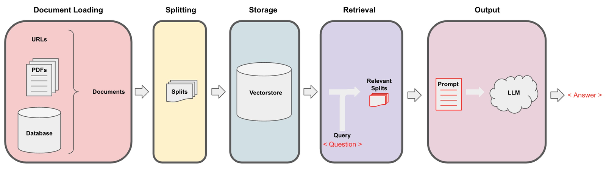<figcaption>Chat with your documents, in five stages. Figure from Dr. Albanna&#x27;s course slides; originally from the DeepLearning.AI short course "LangChain: Chat with Your Data".</figcaption></figure>

Everything is in place for the second phase. A **retriever** is the vector store seen as a chain component: it receives a question and returns documents. Because it is a Runnable, it can be joined with `|` like the components of the first part.

```python
retriever = vector_store.as_retriever(search_kwargs={"k": 4})

def format_docs(found):
    return "\n\n".join(f"[{i}] {d.page_content}" for i, d in enumerate(found, start=1))

rag_prompt = ChatPromptTemplate.from_messages([
    ("system", "Answer the question using only the customer reviews below. If the reviews do not "
               "contain the answer, say that you do not know. Answer in at most three sentences.\n\n"
               "Reviews:\n{context}"),
    ("human", "{question}"),
])

rag_chain = (
    {"context": retriever | format_docs, "question": RunnablePassthrough()}
    | rag_prompt
    | llm
    | StrOutputParser()
)

print(rag_chain.invoke("Is it good for reading?"))
```

The dictionary at the top of the chain is the pattern of Section 6 of the first part. The question enters twice. Under `context` it goes through the retriever and then through `format_docs`, which joins the four chunks into one numbered text. Under `question` it passes through unchanged. The prompt therefore receives both of its placeholders, and steps 5 to 9 of the slides are these few lines.

Two parts of the system prompt do the work that makes this RAG and not ordinary chat. *"Using only the customer reviews below"* keeps the model to the retrieved text. *"Say that you do not know"* gives it a permitted way out, which reduces invention when retrieval finds nothing useful.

### With and without retrieval

Ask the same question with the model alone, and compare.

```python
question = "Is it good for reading?"
print("WITHOUT retrieval:\n", llm.invoke(question).content, "\n")
print("WITH retrieval:\n", rag_chain.invoke(question))
```

Without retrieval the model cannot know what "it" is, so it can only ask or guess. With retrieval it answers about the tablet, from what its buyers wrote. Then ask something that the reviews cannot answer, and see whether the model keeps to its instruction:

```python
print(rag_chain.invoke("Who won the football World Cup in 2010?"))
```

> **Careful: retrieval always returns something.** A similarity search returns the *k* closest chunks even when none of them is relevant: the closest of 363 irrelevant chunks is still the closest. For the football question the retriever hands the model four reviews of a tablet. Whether the answer is then "I do not know" depends entirely on the prompt and on the model. A small model keeps to such an instruction less reliably than a large one, so test this case with every model you use.

### Returning the sources

An answer is more useful when the user can check it. The `assign` pattern of the first part keeps the retrieved documents beside the answer.

```python
answer_chain = (
    RunnablePassthrough.assign(context=lambda x: format_docs(x["documents"]))
    | rag_prompt | llm | StrOutputParser()
)
rag_with_sources = (
    {"documents": retriever, "question": RunnablePassthrough()}
    | RunnablePassthrough.assign(answer=answer_chain)
)

result = rag_with_sources.invoke("How is the battery life?")
print(result["answer"], "\n")
for d in result["documents"]:
    print("source:", d.metadata["review_id"][:8], "| starts at character", d.metadata["start_index"])
```

## 9. Measuring the Retriever

The textbook does not trust a retriever by looking at one example. It measures **recall at *k***: for what share of the questions is the right document among the top *k* results? SubjQA makes this possible, because every question in it was written about one particular review. We can therefore ask each of the dataset's questions about the tablet, and check whether a chunk of *its* review comes back.

```python
test_questions = tablet[["question", "review_id"]].drop_duplicates()
print(len(test_questions), "question-review pairs")

def recall_at(k):
    hits = 0
    for row in test_questions.itertuples():
        found = vector_store.similarity_search(row.question, k=k)
        hits += any(d.metadata["review_id"] == row.review_id for d in found)
    return hits / len(test_questions)

for k in (1, 3, 5, 10):
    print(f"recall@{k}: {recall_at(k):.2f}")
```

Recall rises with *k*, as it does in the textbook: the more chunks are returned, the more likely the right one is among them. A larger *k* has a price, however. Every extra chunk makes the prompt longer, the answer slower, and the relevant passage harder for the model to find. Choosing *k* is a balance between these, and it should be made with numbers of this kind.

> **Note: do not expect a recall near 1 here.** Many SubjQA questions are short and subjective, such as *"How is the experience?"*, and could be about almost any of the 56 reviews. For such a question several reviews are reasonable results, but only one counts as correct. The measure is still useful for *comparison*: change the chunk size or the embedding model, run the cell again, and see whether the numbers go up or down.

## 10. RAG Chain or RAG Agent?

The chain of Section 8 retrieves exactly once, for every input, before the model is called. This is called **two-step RAG**. It is simple, fast and predictable, and it is the right design when every question needs the documents.

Its weakness is the same fixedness. It retrieves for *"hello"*. It cannot search a second time with better words when the first search fails, and it cannot break a question into two searches. In **agentic RAG** the search becomes a *tool*, and the model decides whether to call it, with what query, and how often.

```python-note
# Needs a hosted chat model that supports tool calling (see the optional cell in the first part).
from langchain.agents import create_agent
from langchain_core.tools import tool

@tool
def search_reviews(query: str) -> str:
    """Search the customer reviews of the tablet and return the most relevant passages."""
    return format_docs(vector_store.similarity_search(query, k=4))

agent = create_agent(
    model=llm,
    tools=[search_reviews],
    system_prompt="Answer questions about the tablet from its customer reviews. "
                  "Search the reviews before you answer, and say so when they do not contain the answer.",
)

result = agent.invoke({"messages": [{"role": "user", "content": "Is it good for reading, and how long does the battery last?"}]})
print(result["messages"][-1].content)
```

> **Note: why this example is not in the notebook.** An agent needs a model that can reliably request a tool in a fixed format, called *tool calling*. Large hosted models are trained for it; the small local model of this lesson is not dependable at it. The structure of the code was checked for this lesson with a scripted stand-in model. You will build agents of this kind, with their loop of thought, action and observation, in Weeks 5 and 9.

| | Two-step RAG chain | RAG agent |
|---|---|---|
| Retrieval happens | Always, once | When the model decides, as often as it decides |
| Model calls per question | One | Two or more |
| Speed and cost | Low and predictable | Higher and variable |
| Suits | Questions that all need the documents | Mixed conversation, and questions that need several searches |
| Works with a small local model | Yes | Not reliably |

## 11. From the Lesson to Your Project

The milestone for this week asks for document loaders, a Chroma store and a basic RAG chain. The code of this part is that chain, with three exchanges: your own sources in place of the reviews (Section 4), Chroma in place of the in-memory store (Section 7), and a system prompt written for your topic (Section 8). Measure your retriever on a handful of questions whose source you know before you build on it (Section 9). The requirements themselves are on the [project page](project.html).

## 12. Check Your Understanding: RAG

<details markdown="1">
<summary>1. Give two reasons why pasting the whole knowledge base into the prompt is not a solution.</summary>

A real knowledge base is larger than the context window of any model. Even where it fits, every token is paid for in time and money on every question, and a model answers less accurately when the relevant passage is buried among irrelevant text.
</details>

<details markdown="1">
<summary>2. What is the difference between a sparse and a dense retriever, and when does each one fail?</summary>

A sparse retriever such as BM25 scores documents by shared words; it fails when the question and the document express the same thing in different words. A dense retriever compares embeddings, which encode meaning; it can miss exact rare terms such as product codes, and it depends on how well its embedding model fits the domain.
</details>

<details markdown="1">
<summary>3. In the original RAG paper the retriever and the generator are trained together. What is trained in the system of this lesson?</summary>

Nothing. A ready-made embedding model retrieves, a ready-made chat model generates, and a prompt connects the two.
</details>

<details markdown="1">
<summary>4. Which stages belong to indexing, and which are repeated for every question?</summary>

Indexing is done once: load, split, embed the chunks, store. For every question: embed the question, search the store, build the prompt from the retrieved chunks, and generate.
</details>

<details markdown="1">
<summary>5. With <code>chunk_size=26</code> and <code>chunk_overlap=4</code>, the recursive splitter turns the 33-character text <code>abcdefghijklmnopqrstuvwxyzabcdefg</code> into two chunks. What is the second one, and why?</summary>

`wxyzabcdefg`. The first chunk takes 26 characters. The second starts four characters before the end of the first, which is the overlap, and so begins with `wxyz`.
</details>

<details markdown="1">
<summary>6. Your embedding model reads at most 128 tokens and your chunks are 2,000 characters long. What goes wrong, and will you see an error?</summary>

Only about the first quarter of each chunk is embedded; the remainder is ignored. There is no error. The chunk is stored whole and can be passed to the chat model whole, but it can only be *found* by the content of its beginning.
</details>

<details markdown="1">
<summary>7. Why must the question be embedded with the same model as the chunks?</summary>

Each embedding model has its own vector space. Similarity between a vector from one model and a vector from another has no meaning, and the two may not even have the same number of dimensions.
</details>

<details markdown="1">
<summary>8. A user asks the review chatbot about football, and it answers confidently from tablet reviews. Which part of the system failed?</summary>

The retriever did what it always does: it returned the closest chunks, although none was relevant. The failure is in generation: the model did not follow the instruction to say that it does not know. The remedies are a stricter prompt, a stronger model, or a threshold on the similarity score below which no chunk is passed on.
</details>

<details markdown="1">
<summary>9. Recall at 10 is much higher than recall at 3. Why not simply always use <i>k</i> = 10?</summary>

Every additional chunk lengthens the prompt, which makes the answer slower and, with a hosted model, more expensive. More irrelevant chunks also make it harder for the model to use the relevant one. *k* is a balance between finding the right passage and overloading the model.
</details>

## 13. Summary and Further Reading: RAG

**What you learned:** a language model alone cannot answer from documents it has not seen, and pasting everything into the prompt does not scale. RAG retrieves a few relevant chunks and gives them to the model with the question. It descends from the retriever-reader architecture of extractive question answering, with a generator in place of the reader. Indexing (load, split, embed, store) is done once; retrieval and generation are done for every question. Chunk size must respect the limit of the embedding model. A retriever should be measured, and recall at *k* is the simplest measure. A fixed chain is enough when every question needs the documents; an agent decides for itself when to search.

**Further reading**

- Tunstall, von Werra & Wolf, *Natural Language Processing with Transformers*, Revised Edition (O'Reilly, 2022), Chapter 7. Code and figures: https://github.com/nlp-with-transformers/notebooks
- Lewis et al. (2020), "Retrieval-Augmented Generation for Knowledge-Intensive NLP Tasks": https://arxiv.org/abs/2005.11401
- Karpukhin et al. (2020), "Dense Passage Retrieval for Open-Domain Question Answering": https://arxiv.org/abs/2004.04906
- Bjerva et al. (2020), "SubjQA: A Dataset for Subjectivity and Review Comprehension": https://arxiv.org/abs/2004.14283 · data: https://github.com/megagonlabs/SubjQA
- LangChain documentation, retrieval: https://docs.langchain.com/oss/python/langchain/retrieval
- LangChain documentation, building a semantic search engine: https://docs.langchain.com/oss/python/langchain/knowledge-base
- LangChain documentation, building a RAG agent: https://docs.langchain.com/oss/python/langchain/rag

**Figure credits.** The three architecture figures come from the textbook's companion repository and are used under its Apache 2.0 licence. The indexing and retrieval figures come from the LangChain documentation and are used under its MIT licence. The remaining figures come from Dr. Abdulkarim Albanna's course slides. Of these, three originate from the SwirlAI Newsletter (newsletter.swirlai.com), as marked on them, and three (the data sources, the five-stage pipeline, and chunk size and overlap) from the DeepLearning.AI short course "LangChain: Chat with Your Data". Product logos that appear in the figures are trademarks of their owners.

## Test code

### Split your own text and inspect the chunks

```python
from langchain_text_splitters import RecursiveCharacterTextSplitter

text = ("RAG has two stages. First the documents are indexed.\n\n"
        "Then a question is answered: the retriever finds the chunks closest to the question, "
        "and the model writes an answer from them.\n\n"
        "A chunk that is too large is cut off by the embedding model. A chunk that is too small loses its context.")

splitter = RecursiveCharacterTextSplitter(chunk_size=80, chunk_overlap=0)
for chunk in splitter.split_text(text):
    print(len(chunk), repr(chunk))
```

### A vector store in five lines, with a stand-in embedding model

```python
from langchain_core.embeddings import DeterministicFakeEmbedding
from langchain_core.vectorstores import InMemoryVectorStore

store = InMemoryVectorStore(DeterministicFakeEmbedding(size=64))
store.add_texts(["Petra is a historical city in southern Jordan.",
                 "Amman is the capital of Jordan.",
                 "BERT is an encoder-only transformer."])
for doc, score in store.similarity_search_with_score("Amman is the capital of Jordan.", k=2):
    print(round(score, 3), "|", doc.page_content)
```
